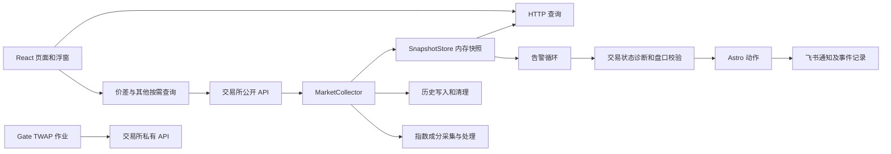
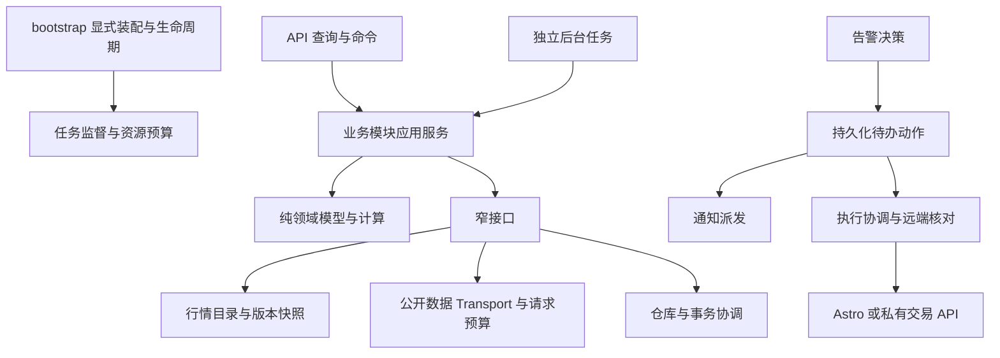

# 套利系统架构评估与分阶段优化方案

日期：2026-09-25。交付对象：后续负责实施的 6-sol。

## 1. 范围、基线与结论

本任务只调查和设计，不修改业务代码、不运行生产入口、不发送通知、不创建交易或 Astro 卡片、不部署。仅新增本文档。

- 调查分支：`codex/frontend-localization-polish`。
- 调查基线：`4614af4f6584ba51e6caf6dd3f61d620a9f3eb7c`。开始时没有已跟踪文件修改。
- 调查方式：源代码、部署配置、测试目录、近期交接文档的静态检查。未做当前生产剖析、数据库体积统计、在线压测或全量测试。
- 结论：采用“模块化单体 + 有界后台任务 + 共用行情基础设施 + 独立副作用流程”。第一阶段继续使用 React、FastAPI、单个后端进程和 SQLite。
- 核心目标：慢模块不拖慢行情；进程存活与业务健康可区分；缓存和并发有上限；外部动作可追踪；每次修改的影响范围可控。
- 不以减少代码总行数为验收条件。不要为了拆文件新增服务网格、Kafka、Redis、微前端或一套通用插件框架。

本文的“已确认”指代码结构或明确控制流；“风险”指特定条件下可能发生的行为；没有测量的数据不写成已发生的线上事故。

## 2. 当前系统与应保留的基础

统计范围不含测试、第三方依赖、生成文件与工作树副本：

| 项目 | 当前规模 |
| --- | --- |
| `backend/app` Python | 135 文件，42,709 行 |
| `frontend/src` TS/TSX/CSS | 38 文件，36,694 行 |
| `services/pair_spread_query.py` | 4,197 行 |
| `pages/PairMonitorPage.tsx` | 6,064 行 |
| `frontend/src/styles.css` | 7,708 行 |
| `backend/app/main.py` | 1,112 行，13 处具名后台任务启动调用，实际启动数受开关控制 |
| `db/repositories.py` / `db/schema.py` | 1,832 / 685 行 |
| 前端 API 类型 / 客户端 | 2,546 / 1,489 行 |
| 测试文件 | 后端 63 个 `test_*.py`，前端 20 个 `.test.*`；不是测试通过数 |

当前主链：



应保留的现有设计：

1. `api_app` 禁止后台 worker，生产 `app` 才启动行情链；已有通知实发开关。后续重构必须保持该隔离。
2. 采集器已有分交易所状态、轮转调度、超时退避和 PoolTimeout 重建连接池。不能把这些功能重新当成缺失项。
3. 市场模型已有原始 symbol、DEX、合约倍率、别名倍率、来源、上游时间、预估字段；机会 ID 已考虑精确市场信息。
4. 告警已有连续命中、稳定性判断、深度验证、失败重试，以及 Astro 路线冲突检查；不是从零实现风控。
5. SQLite 已开启 WAL、busy timeout、外键；历史已采样和保留期清理。
6. 前端已经按页面懒加载；实时机会有防重入和隐藏页暂停，浮窗使用串行刷新，标的查询最近修复了诊断刷新跳动。问题是各页策略分散，不是所有页面都无节制轮询。
7. 生产已有固定 SHA 预构建镜像、备份后快进更新、`--no-build` 启动；不回退到小内存生产机现场构建。
8. “分钟价差信号”和“新币极速”已退役，交易所公告仍保留。不能在重构中恢复旧 worker、路由或删除遗留历史表。

## 3. 缺陷与风险证据

### A01：行情主循环等待非行情工作，配置间隔不等于实际刷新周期（高优先级）

证据：`backend/app/services/collector.py:171` 的 `collect_once()` 在发布快照后依次等待历史记录（212）与指数处理（213）；`run_collector_loop()`（474）结束一次采集后再等待配置间隔。每轮默认最多选择 3 个 adapter（35），默认列表有 10 个。

影响：历史清理、指数接口或同一批最慢的 adapter 都会延迟下一轮。正常情况下，如果 10 个来源都到期、没有其他主动采集调用，仅按每轮最多 3 个计算，一次覆盖就需约 4 轮；`POLL_INTERVAL_SECONDS=5` 不能解读成所有交易所每 5 秒更新。这是控制流推导，不是当前生产实测延迟。

设计：先把历史和指数从行情关键路径移到独立消费者，再让 adapter 按独立截止时间调度，在总并发预算内完成一个发布一个。保留轮转公平性、每源 in-flight 防重入、现有退避与部分失败语义。

验收：注入指数接口长延迟、慢历史清理和一个慢交易所，其他来源仍在预算内发布；报告每源完成时间、数据年龄和超期次数，而不是仅报告轮询配置。

### A02：实时缓存只限制单序列长度，没有限制序列总数（高优先级）

证据：`services/pair_spread_query.py:510` 起四个模块级 `_REALTIME_*_CACHE`；单序列最多 4,000 点，但缓存 key 含交易所、市场、DEX、symbol、倍率和周期，未见 key 总数上限或全局过期淘汰。

影响：持续切换标的、组合和周期会留下更多序列。单曲线有界不等于进程缓存有界。可以确认增长路径，不能据此断言现有生产 OOM 就是它造成的。

设计：专属 `RealtimeSeriesStore`，统一最大 key 数、总点数、空闲 TTL、近似内存预算和淘汰计数；保留实时采样不等于交易所历史的来源语义。报价、历史曲线、元数据分别缓存，不能使用同一个 TTL。缓存不存账号密钥或私有响应。

验收：连续查询超过最大 key 数的组合后，key/点数保持预算内；DEX、倍率、周期互不串线；淘汰后显示采样重新开始，不能伪造连续历史。

### A03：昂贵按需查询有独立客户端，缺少跨模块统一请求预算（高优先级）

证据：`api/routes_pair_spread.py:227,392,485,556,639` 各自创建服务并在 finally 关闭；`PairSpreadQueryService:954` 默认新建 HTTP 客户端。`main.py` 还分别为行情和交易状态服务创建 adapter 集合。价差服务内同时包含多家交易所的行情、K 线、资金费率、OI 解析。

影响：频繁查询时短生命周期连接池和元数据缓存复用差；行情、页面查询和监控分别有局部控制，但没有统一的交易所/IP 请求预算。实际重复请求量和限流占比待测。

设计：进程级公开数据 Transport 与 RequestBudget，由能力 provider 使用；按交易所/endpoint 权重限流，给告警盘口保留预算，历史查询有队列上限与分页上限。私有交易客户端独立隔离。只把 Transport 和安全元数据做共享，不把包含可变查询状态的整个巨型服务直接变成全局单例。

验收：同一公共只读请求并发到达时合并请求；一个调用者取消不会取消其他等待者；429 尊重 Retry-After；451 维持受限状态和冷却；慢历史请求不会耗尽告警盘口预算。

### A04：健康检查不能发现关键任务停止推进（高优先级）

证据：`api/routes_health.py` 在能读取配置时固定给出 `status: ok`，虽含交易所状态，但没有关键任务心跳、最后成功、快照年龄或队列积压；`main.py:320` 的启动 helper 仅调用 `asyncio.create_task`。Compose 用该接口的 HTTP 成功判断健康。

影响：行情任务退出或长期不推进时，HTTP 仍可能返回 200；主循环有异常日志，但不是完整的任务监督。不能把已有 `exchange_states` 误说成完全没有健康信息。

设计：分开 `live`、`ready` 和业务诊断。live 表示进程/事件循环响应；ready 表示必要资源初始化完成；业务诊断报告行情年龄、告警和执行任务状态。外部某个交易所降级不应触发无限容器重启。

验收：主动结束关键任务后状态能暴露；API-only 模式不会因没有采集器误判；短暂外部断网不会形成重启风暴；任务退出、卡住和正常空闲可区分。

### A05：告警等待外部请求后，校验用的行情和时间可能过期（高优先级，条件性行为缺陷）

证据：`main.py:373` 取得本轮 `now`；409 读取 latest opportunity；425 等待交易可用性诊断；440 用之前的对象和 `now` 调用 `_latest_signal_validation_failure`；之后仍有盘口请求和 Astro 操作。

影响：诊断较慢、机会撤销或价格明显变化时，所谓“最新校验”并不保证动作前的新鲜度。多条告警串行执行会放大等待。并非证明线上已经错误建卡。

设计：诊断完成后重新读取快照与当前时间；形成带 `snapshot_version`、双边行情时间、目标金额和 `valid_until` 的校验结果。盘口校验完成后、真正产生外部动作前再检查机会仍存在、未过期、规则与路线未改变。超期则取消或重新校验，不能只刷新时间戳冒充新验证。

验收：用受控时钟和延迟 provider 模拟诊断期间行情失效、盘口期间机会消失、队列排队超时，均不得建卡；正常条件保持既有规则结果。

### A06：通用告警冷却与副作用缺乏持久化闭环（高优先级）

证据：`services/alert_engine.py:30` 起 `_last_sent`、`_retry_after` 等为内存字典；`main.py:535` 起发送通知，随后才更新内存结果与写事件（563）。Astro 行为也在同一循环内执行。已有事件表不能自动等同于持久化冷却/待发送任务。

影响：重启丢失冷却；外部成功但本地记录前崩溃会留下不确定状态。通知、诊断和建卡串行耦合，慢动作拖延后续匹配。Astro 已有远端现存卡检查，但“先查询再创建”不是跨协程原子操作。

设计：先在本地事务中记录告警决策与待办动作，再执行外部动作；通知、Astro 建卡分别有状态和错误。保留现有通知抑制业务规则，通过显式结果依赖表达，不能拆开后意外多发提醒。持久化冷却；成功按渠道记账，失败保持现有退避语义。每个精确 Astro 路线使用唯一业务键和并发认领。

重要限制：飞书 webhook 如果没有幂等机制，无法保证网络不确定情况下严格只送达一次。状态应包含 `unknown`，记录重试策略与可能重复；交易/建卡不确定时先向远端核对，不能盲重试。

### A07：Gate TWAP 作业只保存在内存，订单关联 ID 粒度偏弱（启用实盘时高优先级）

证据：`services/gate_twap.py:451` 的 `jobs/tasks` 为内存字典，start 创建内存 task；524 使用 `%m%d%H%M` 生成 run_id，切片 text 由前缀、分钟和序号组成。不同作业在同一分钟使用同前缀时可能生成相同 text。不能假设交易所会按该 text 幂等拒绝。

已有保护：live 需要显式确认和凭证，订单使用 `reduce_only`；这些必须保留。

设计：持久化 Job/Slice/Attempt 与稳定唯一的客户端订单关联键；发出前落库，返回后记录交易所订单 ID。重启将未决切片标为待核对，核对实际订单/成交/仓位后人工或明确策略恢复，默认不自动追赶补单。作业归档和事件保留有上限。

验收：同分钟前缀相同的两个作业关联键不同；模拟发送成功后断进程，重启能找到未决切片且不重复发单；取消、部分成交、请求超时和 dry-run 各自有明确定义。全部用 fake provider 验证，不发送真实订单。

### A08：SQLite 使用方式耦合维护和业务事务（中高优先级）

证据：`main.py:729` 生命周期创建一个连接交给多个仓库；`db/repositories.py` 多处独立 commit；`services/history.py:61` 清理后在行情调用链中执行 VACUUM。`db/schema.py:111` 启动时集中创建和补列，未见版本化迁移注册表。

影响：同一连接上的多个协程操作没有天然独立的业务事务边界；加入“事件+待办”这样的多语句事务前必须处理。VACUUM 是数据库级重操作，WAL 不会让它变成免费或无锁操作。不能仅根据代码认定已有数据库损坏或锁冲突。

设计：首先建立共享写入协调器/事务边界，禁止一个事务内调用会自行 commit 的旧仓库方法；逐步迁移高风险写操作。读连接按需求少量独立，写入继续短事务。增加版本化、可重复验证的迁移；批量清理在维护任务中执行，VACUUM 根据空闲页和维护窗口决定，不能每次启动就做。

验收：故障注入证明事件和待办动作同时提交或回滚；并发写不会提交其他任务的半成品事务；新库与代表性旧库副本都能升级；维护期间采集不等待，DB 延迟和磁盘占用有观测。

### A09：大文件跨越多个职责，修改一个交易所或图表需理解过多上下文（中优先级）

证据：价差后端将 HTTP、交易所路由、解析、缓存、时间对齐、统计混在同一文件；前端 PairMonitor 同时含图表、查询、预设、资金费率、日对比和 URL 状态；通用 client/types 和全局 CSS 集中增长。

设计：按功能边界拆分，保留原导入路径/接口薄门面逐步迁移。抽取纯计算与 provider 先行，业务结果不变后再考虑优化算法。多个模块共享的只有稳定契约和基础设施，不把所有 service 改名移动到同一个“公共服务”大文件。

验收：已有案例新旧结果一致；模块导入方向可静态检查；一个交易所解析变更不涉及页面代码；一个图表样式变更不影响其他页。

### A10：契约与刷新状态分散，缺少统一取消、去重与数据来源表达（中优先级）

证据：Pydantic 与 `frontend/src/api/types.ts` 手工维护两套结构；`api/client.ts:162` 的通用 fetch 没有统一默认超时；页面各自维护轮询和请求状态。`InstrumentLookupPage.tsx:310` 诊断关联 key 与 `spread_engine.py` 的完整机会身份用途不同。

设计：从 OpenAPI 生成传输 DTO，保留手写 ViewModel/兼容解码层；先引入轻量公共请求层与 `usePollingQuery`，覆盖超时、取消、防重入、旧请求隔离、可见性、退避、保留上次成功结果。不要一次强制全部换状态管理库。

市场 ID 需分层：交易场所身份和展示转换身份分别建模；诊断可按场所身份关联，机会/缓存必须考虑倍率与方向。不可直接把每个 key 都改成同一串字段而不审查用途。行情时间、诊断时间和资金费率结算时间继续分别显示。

SSE 备注：仓库有 `/api/stream`，当前检查的前端源文件未见 EventSource 使用。服务端每客户端每 2 秒序列化 Top 200。先统计使用情况再决定保留；不要为“实时”立即新增 WebSocket。若启用 SSE，应按快照版本共用序列化并限制慢客户端。

### A11：CI 有镜像构建，没有测试发布门禁；依赖解析不完全可复现（中优先级）

证据：`.github/workflows/build-production-images.yml` 当前只构建推送双镜像；前端 Docker 构建会做 tsc/Vite，但没有跑 Vitest；后端没有 pytest 步骤。`backend/pyproject.toml` 依赖使用下界，Docker 执行 `pip install .`，未使用锁文件。

设计：增加后端/前端测试、类型构建、迁移与模块边界检查后才产出可发布镜像；固定后端依赖解析，定期独立升级。保持 SHA 镜像和 digest 记录，不在小内存服务器跑构建。

验收：故意让一个测试失败时不会发布合格镜像；同锁定输入安装相同依赖；功能分支能运行检查，发布仍遵守现有分支和备份流程。

### A12：空密码时写操作鉴权放行，执行功能需要明确配置边界（条件性高风险）

证据：`core/security.py:4` 在 expected_password 为空时直接返回；TWAP 创建/取消使用该验证；Compose 默认密码为空且映射后端端口。前端把密码放在 localStorage。没有读取生产秘密，因此不知道生产是否配置密码、是否有网关保护。

设计：开发只读模式可以无密码；生产启用外部动作/管理写入时无凭证应拒绝启动该能力或拒绝对应请求，并保持关闭状态可观测。区分 read/configure/execute 能力。会话与凭证存储的完整升级可另开任务，不必借架构重构重做用户系统。

验收：缺密码的生产执行请求被拒绝；API-only 不意外开放实发；敏感响应/日志不泄露密钥；验证现有部署方式后再调整兼容策略。此项不等于声称生产已公开裸奔。

## 4. 目标架构与模块责任



建议逻辑边界，可逐步建立，不要求一轮搬完目录：

| 边界 | 负责内容 | 禁止依赖 |
| --- | --- | --- |
| `bootstrap/runtime` | 配置、资源装配、任务启停、状态和关闭顺序 | 不写交易策略 |
| `market_data` | 市场目录、公开数据 provider、精确身份、快照与来源 | 不通知、不创建卡片 |
| `spread` | 机会、双边查询、资金费率/价格归一和统计 | 不访问 FastAPI Request、不直接下单 |
| `alerts` | 规则、连续命中、决策、冷却、动作意图 | 不直接控制私有客户端 |
| `execution` | Astro/TWAP 作业、幂等认领、审计、远端核对 | 不私自改变告警规则 |
| `monitoring` 各子模块 | 指数、负溢价、交易可用性等自己的配置和采样 | 不写其他模块的表 |
| `research` / `news` | 回测与研究、公告与原油新闻 | 不能阻塞行情热路径 |
| `infrastructure` | HTTP、SQLite、clock、日志、指标的薄封装 | 不包含业务条件分支 |

依赖方向为 API/worker → 应用服务 → 领域计算与接口；基础设施实现接口，bootstrap 负责装配。无需引入大型 DI 框架、泛型仓库或通用事件总线。

目标目录示意：

```text
backend/app/
  main.py                   # 保留入口与薄兼容导出
  bootstrap.py
  runtime/                  # task supervisor, status, budgets
  domain/                   # market identity, quote quality, pure shared values
  modules/
    market_data/
    spread/
    alerts/
    execution/
    index_components/
    negative_basis/
    research/
    news/
  infrastructure/           # transport, database, clock

frontend/src/
  app/                      # shell, navigation
  shared/api/               # generated DTO + transport
  shared/query/             # polling, cancellation, query identity
  features/
    pair-monitor/           # hooks, charts, panels, view-model, css
    instrument/
    alerts/
    ...
```

## 5. 关键技术契约

### 5.1 行情身份与版本

- `VenueMarketId`：exchange、market_type、raw_symbol、dex；明确区分 Lighter 与 RH-Lighter。
- 合约倍率属于市场合约元数据；别名价格倍率属于显示/计算转换。它们必须随结果保留；完整机会/曲线 key 在市场 ID 之外包括双方转换版本、倍率、方向、采样周期等影响结果的输入。
- 保留原生 quote/settlement 口径；若显示 USDT 等价值，记录转换依据，不能把 USDC 和 USDT 暗中当成相同的可成交现金流。
- `QuoteQuality`：来源、上游时间、接收时间、预估字段、失败原因。各数据维度独立过期；诊断未知不等于市场关闭。
- `SnapshotVersion`：发布序号、发布时间、各市场真实观测时间、受影响市场集合、配置版本。统一发布使消费者能判断是否为同一批结果。
- 不因每次循环重新生成对象就当成新的行情观察。连续命中是否必须来自不同市场观测，属于告警业务语义，先加案例固定再单独决策，不混入机械重构。
- 原来的 opportunity ID 对告警历史和冷却有影响；第一轮保持算法，未来变更必须版本化并迁移映射，避免重置全部冷却。

### 5.2 任务监督、队列与优先级

每个 TaskSpec 显式声明：名称、开关、启动依赖、间隔、超时、是否可自动重试、停止方法。记录 started/heartbeat/last_success/error/restart_count。外部交易任务不得因为通用监督器“重启 coroutine”就重复发送。

不同工作使用不同积压策略：

- 行情最新状态：按市场合并，只保留最新待处理版本。
- 图表/可选统计：允许有界丢弃，但必须计数和显示数据缺口。
- 指数变更：若需保留每次已观测的成分变化，应先持久化观测/变更；不能简单用 latest-only 队列吃掉中间变化。
- 告警、订单意图和审计：持久化，不默默丢弃；磁盘/队列压力到阈值时拒绝新增外部动作并暴露错误。

先设小而明确的限额，再按基线测量调整。为实时行情和盘口校验预留预算，历史查询/回测低优先级；长期饥饿也必须可观测。取消某个模块不能关闭其他模块共用的 transport。

### 5.3 副作用状态机

建议最小状态：`pending → claimed → succeeded / failed / unknown / cancelled`。记录业务幂等键、尝试 ID、下一次重试时间、远端 ID、错误与有效期。认领用事务或条件更新，不用“先查再写”。

通知与交易不共享重试策略。通知可按明确规则重试并接受极少量不确定重复；交易和建卡先核对远端。过期告警不得在恢复后补建开启状态的卡片。持久化 intent 与冷却不能因持久化失败而继续执行。

保持既有 Feishu 与 oil-news 实发许可的区别、Astro 自动/手动/预建卡/Live Pilot 开关、TWAP confirm_live 和 reduce_only。实现人员不得用新的总开关悄悄放大授权范围。

### 5.4 数据库与迁移

继续 SQLite。新增少量状态表：schema migrations、告警冷却/决策、动作待办/尝试、执行作业/切片；由相应模块拥有，不一次创建所有未来可能用的表。

迁移采用 expand → migrate → contract：先增加兼容字段/表，验证后切换读写，观察稳定再考虑删除。不要同时双发副作用；影子模式只算不执行。真实数据库只做受控备份，测试使用临时库或脱敏副本。

若将来拆历史库，先测每表增长和读写成本；数据库拆分后不能假定跨库事务仍然成立。只有单进程与 SQLite 的实测容量或隔离需求不满足时，再评估 PostgreSQL 或独立 worker。

## 6. 产品与前端减负

建议把 19 个同层入口整理为五组，而非马上删掉功能：

1. 行情与机会：实时机会、标的查询、双边价差、单标的价差。
2. 监控与告警：资金费率、机会雷达、溢价/负溢价、指数成分、传统资产。
3. 研究工具：资金费率研究、秒级采样、插针回测。
4. 执行与账户：Astro 相关操作、Gate TWAP、账户连接；强调只读与执行状态。
5. 资讯与系统：公告、原油新闻、参数、历史。

这只是导航设计，须保留旧 URL 和已保存预设迁移，不借此扩大删除范围。高级能力按显式配置启用；隐藏菜单不等于停 worker，页面开关与后台能力开关必须有清楚关系。

PairMonitor 建议拆成：查询表单、查询 hook、价差曲线、资金费率面板、OI/成交额面板、日对比、预设/URL 转换、纯统计工具。全局 CSS 保留 reset/token/基础布局，功能样式迁到对应 feature。保持紧凑密度与现有移动端使用方式。

## 7. 给 6-sol 的执行顺序

每一行都是单独任务/小型交付单元，遵守一个任务一个主要模块。先做证据和可靠性，再做目录与 UI 重构。不要一次启动全表实施。

| 阶段 | 独立任务与入口 | 完成条件 | 回滚方式 |
| --- | --- | --- | --- |
| T0 | 架构基线与发布门禁：workflow、测试和依赖 | 保存离线基准、API 契约；测试失败不可发布；锁定后端依赖 | 恢复 CI/锁配置，不触碰业务数据 |
| T1 | 运行时可观测：main helper、health、生命周期 | live/ready/worker 状态明确；关键任务失败可测；关闭不泄漏资源 | 旧 health 兼容字段保留，回退镜像 |
| T2 | 价差查询缓存与公共请求预算：pair query/provider | 缓存总预算、共享公开 transport、超时和请求合并；不串 DEX/倍率 | 切回旧查询门面；缓存可清空，提示采样缺口 |
| T3a | 历史存储与维护：history/repository | 从采集路径移出；写入/迁移边界明确；维护可控 | 暂停新维护任务，兼容表保留 |
| T3b | 指数任务解耦：collector/index components | 保留变更记录与提醒语义；慢指数不拖行情 | 只切一个 owner，不能新旧任务同时运行 |
| T4 | 行情调度与版本快照：collector/store | 各源独立推进、总并发有界；旧退避和 stale 行为不变 | 切回旧调度器，禁止双采集器争写 |
| T5a | 告警动作前时效校验：alert loop | 延迟/失效故障注入不建卡；保留正常匹配结果 | 独立小提交，回退旧镜像但明确旧风险 |
| T5b | 告警持久化与动作派发：alerts/outbox | 重启冷却保留；未知结果可核对；通知规则不变 | 停派发并核对未决动作，禁止直接回退导致双发 |
| T6 | 执行作业与权限边界：Gate/Astro/security | 唯一关联键、未决核对、实发授权不扩大 | 暂停新执行、核对全部未决，再决定回滚 |
| T7 | 价差领域与交易所 provider 拆分 | 接口、公式、历史结果、错误语义一致；导入边界受检 | 保留薄门面，按 provider 回退 |
| T8a | 前端请求契约与刷新基础层 | DTO 漂移可检测；超时/取消/换标的/旧结果提示通过 | 按页面逐个迁移，可逐页回退 |
| T8b | 双边价差页面组件与样式拆分 | 预设/URL/图表/移动端视觉回归通过 | 回退该 feature，不动共享协议 |
| T9 | 导航分组、可选模块启停 | 旧链接可迁移；关闭能力确实不创建其任务和客户端 | 保留旧页面键兼容，配置可还原 |

优先级调整：T5a 是独立且影响交易判断的修复，可在 T1 后提前完成；若当前启用了 Gate 实盘，T6 的作业核对和鉴权边界应提前；不可因此跳过事务和迁移前置条件。所有阶段先用 fake transport，默认关闭真实副作用。

不立即做：增量机会计算、后台回测独立进程、读写库拆分、跨浏览器窗口统一推送。先测 CPU、内存和请求数；如果全量机会构建确实占用事件循环，再按受影响标的重算，并验证配置变更/过期淘汰也会触发重算，不能只监听价格变化。

## 8. 验收与测量口径

所有数字先采集当前基线；以下是建议的工程门槛，不是已测性能结论。

### 必须通过的正确性用例

- Hyperliquid main 与其他 DEX 同 ticker 不合并；Lighter 与 RH-Lighter 分开；同名不同资产、1000 倍合约、别名价格倍率可追溯。
- 1h/4h/8h 资金费率同时保留原周期与归一结果；预估费率不冒充结算值；双方成交额、手续费和实际盘口价格完整。
- stale、缺深度、midpoint/预估 bid-ask、交易诊断未知时不被误当作可执行套利。
- 换标的期间迟到请求不覆盖新结果；行情成功诊断失败时保留旧诊断并显示时间与错误；浮窗/独立窗行为保持。
- 缓存淘汰、429/451、单所超时、关键 worker 退出、DB 写失败、关闭取消都可测试。
- 通知/建卡/订单在“发送前、发送后未落库、落库后”崩溃分别有明确恢复行为。
- 旧数据库升级、新数据库初始化、开关关闭、API-only 无后台任务、退役接口继续 404。

### 观测与容量

采集 30 分钟正常负载和固定故障注入样本；涉及内存上限/缓存的改动再做 24 小时稳定观察。记录：各源数据年龄 p50/p95/p99、采集超期、HTTP 延迟/429、事件循环延迟、RSS/容器内存、缓存 key/点数/淘汰、DB 写入延迟/WAL 大小、任务最后成功和队列深度。

- 缓存 key/总点数任何时候都不得突破配置上限；过载有显式拒绝或降级。
- 同一数据集、同一请求数下 API p95 不应比基线恶化超过 10%；关键行为修复引入的必要额外校验应单独记录成本。
- 对健康来源，建议数据年龄 p95 小于产品允许的 stale 阈值，并与调度周期/网络预算匹配；受限来源应标记不可用，不能放宽 stale 阈值掩盖落后。
- 历史/指数故障不应显著推高其他来源更新时间；按相同 fake transport 验证可确定的界限。
- 现有生产 override 限额是 backend 768 MiB、frontend 96 MiB。以后台容器限额约 75% 作为预警起点，最终预算需结合全主机和其他容器测量；达到阈值应收缩可选负载而非只增大上限。

推荐回归入口：

```text
backend/tests/test_collector.py
backend/tests/test_exchange_resilience.py
backend/tests/test_pair_spread_query.py
backend/tests/test_spread_engine.py
backend/tests/test_symbol_aliases.py
backend/tests/test_orderbook_validator.py
backend/tests/test_alert_engine.py
backend/tests/test_alert_loop.py
backend/tests/test_astro_alerts.py
backend/tests/test_repositories.py
backend/tests/test_history.py
backend/tests/test_index_components.py
backend/tests/test_api.py
frontend/tests/ApiClient.test.ts
frontend/tests/PairMonitorPage.test.tsx
frontend/tests/InstrumentLookupPage.test.tsx
frontend/tests/FloatingWatchPanel.test.tsx
frontend/tests/AppShell.test.tsx
```

按任务风险选择定向回归；改变共享身份、调度、事务或执行机制后跑全量后端和前端测试、生产构建。新增测试应覆盖故障与业务边界，不为文件移动写实现镜像测试。

## 9. 发布、回滚与线上状态

本任务未联系服务器，当前线上版本和运行指标未知。仓库近期交接提供的是历史证据：监控裁剪、标的查询与成交额比率已有交付记录；小内存事故推动了预构建发布方案。不能把文档中的旧健康检查当成本方案的当前验证。

每个实施任务：检查工作区 → 只修改本模块 → 回归 → 更新交接 → 精确暂存 → 提交并推送 → 等待测试与固定 SHA 镜像 → 备份 `/data/radar.db` 并校验 integrity/hash → `git pull --ff-only` → 拉固定镜像并 `up --no-build --wait` → 验证容器、健康与实际功能。执行当前 `docs/git-delivery-checklist.md`、`docs/linux-deployment.md` 和 `deploy/linux-update.sh`；不得 `down -v`。

影子比较只用于纯计算，不双发通知、不双建卡、不双下单。带持久化动作的回滚必须先暂停派发、盘点 pending/claimed/unknown，明确新旧消费者所有权。代码回退不等于恢复旧数据库；直接恢复数据库备份可能抹掉备份后真实交易审计，需要专门核对。

## 10. 本次交接状态与下一步

- 已完成：主要调用链、任务生命周期、请求/缓存、数据库、前端结构、CI 与执行状态的静态调查；本文设计与实施拆分。
- 未完成且不属于本任务：代码实现、性能压测、自动测试、Git 推送、数据库备份和部署。
- 本任务产物仅本文档；没有更改业务文件或已存在的交接文档。
- 已存在的未跟踪内容包括 `.worktrees/`、`output/` 多个截图/浏览器产物、`script/dexe_bybit_bitget_chain.py`、`backend/.pytest_module_prune_20260925/`、`docs/task-handoff-2026-09-24-spread-alerts-aster-production.md`。全部保留，不能顺手清理或提交。
- 部分 pytest 临时目录已有 Windows ACL 读取警告，不视为业务缺陷。

交给下一任务的起始指令：

> 阅读 AGENTS.md 和 docs/task-handoff-2026-09-25-architecture-optimization.md。以当前分支最新状态重新核对基线。本任务只实施 T0：架构基线与发布门禁，不开展后续模块。先固定现有身份、接口和关键行为的离线验证，增加测试发布门禁和可复现依赖。避免导入生产入口造成真实后台副作用，不连接实盘或发送通知。保留工作区其他改动。完成定向验证、提交推送、按项目现行交付规则验证部署并更新本模块交接；若环境阻塞，如实记录，不能声称线上完成。结束后再为 T1 开新任务。

若希望先修风险，另开 T5a 小任务，明确仅修“外部等待后的动作前时效校验”，不同时重构整个告警引擎。
