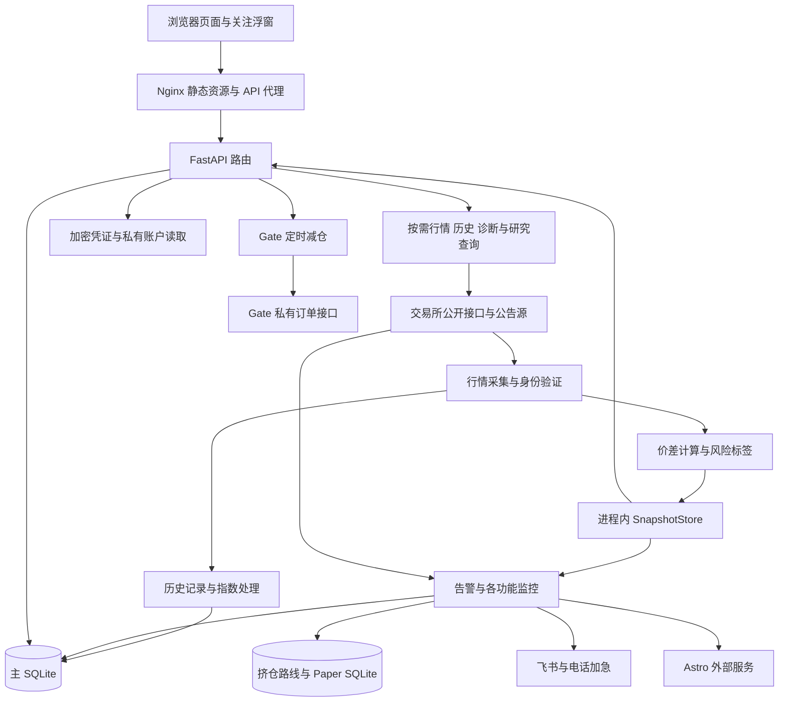
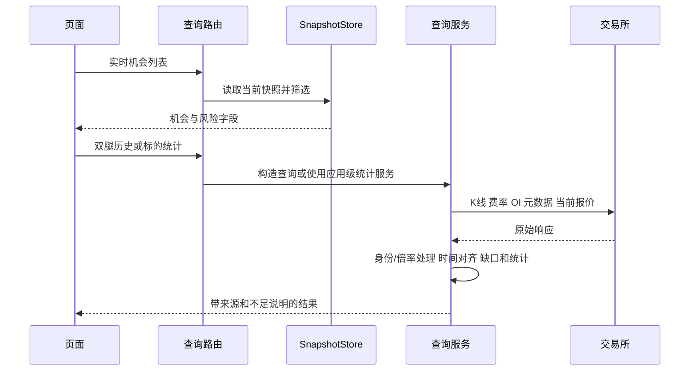

# taoli1 系统设计说明与架构审阅交接

日期：2026-10-23，Asia/Seoul。用途：交给 Claude 理解现有系统、核查复杂度来源，并提出可分阶段实施的优化方案。

这是一套以公开市场监测为核心、同时包含研究回测、通知、账户查询、Astro 建卡和 Gate 减仓工具的模块化单体。主要复杂度来自多个功能共用运行时、外部数据访问方式分散，以及少数大文件承担过多职责。是否删除功能、拆进程或更换数据库，应结合功能使用情况和实际负载判断。

本交付属于“系统架构审阅文档”模块，验收目标是完整说明当前设计、提供可定位代码的索引、明确业务约束和后续审阅任务。本次只新增文档和更新文档入口；没有实现优化、改业务配置或执行线上操作。

## 1 阅读方式与版本边界

| 项目 | 内容 |
| --- | --- |
| 本地仓库根目录 | `C:\Users\wubin\Desktop\code\codex\taoli1` |
| 分支 | `codex/frontend-localization-polish` |
| 源码核对基线 | `18348c4ae219a3d58c079f20c042f8b6ff8c2b8e` |
| 最近功能提交 | `2e9afa2fb502c437f6bb87637e3bd0823adab8bd`，大价格差组合比值显示 |
| 已有未提交修改 | [frontend/src/pages/PairMonitorPage.tsx](C:/Users/wubin/Desktop/code/codex/taoli1/frontend/src/pages/PairMonitorPage.tsx)、[frontend/tests/PairMonitorPage.test.tsx](C:/Users/wubin/Desktop/code/codex/taoli1/frontend/tests/PairMonitorPage.test.tsx)，页面布局 WIP，保留原样 |
| 本文统计口径 | 当前工作区，包含上述 WIP；源码行数包含空行和注释，不含测试、依赖、构建输出 |
| 生产信息 | 来自仓库最近交接记录，本文未重新 SSH 验证，不视为此刻线上状态 |

配套 [docs/system-code-map-2026-10-23.md](C:/Users/wubin/Desktop/code/codex/taoli1/docs/system-code-map-2026-10-23.md) 给出全部应用源码的绝对路径、行数、API 方法与路径、后台任务启动位置和数据表归属。本文先按职责说明设计，索引用于逐文件复核。

建议 Claude 先读第 2～4 节建立整体模型，再读第 5～10 节核查关键路径，最后逐项审核第 12～14 节。旧文档 [docs/task-handoff-2026-09-25-architecture-optimization.md](C:/Users/wubin/Desktop/code/codex/taoli1/docs/task-handoff-2026-09-25-architecture-optimization.md) 仅作历史参考，不能直接按其旧行号和旧结论改代码。

## 2 系统目标与功能边界

主要工作流是“发现市场差异 → 确认同一资产和计量单位 → 查看可执行价格、成本和状态 → 通知或建立外部交易工具卡片”。系统支持 SF、FF、SS 机会；新增 FS 观察模块针对买入永续、借币卖出现货的负费率场景。一般的价格比值、同名代码、负费率或公开借币上限都不能独立证明套利可执行。

功能可分为五组：

| 功能组 | 用户用途 | 是否可能产生外部动作 |
| --- | --- | --- |
| 行情与机会 | 实时机会、标的查询、价差查询、跨所价差、溢价指数、资金费率套利 | 查询本身以读取和计算为主；页面可进入监控/建卡操作 |
| 研究与观察 | 资金研究、FS、负基差、挤仓结构、秒级采样、乌龙回测、TradFi | 部分监控会通知；资金研究/挤仓 paper 为模拟；FS 可建立停用卡 |
| 事件监控 | 交易所公告、指数成分变化、原油新闻、电话价格告警 | 飞书消息和配置允许的电话加急通知 |
| 账户与执行连接 | 账户连接、仓位浮窗、Astro 卡片、Gate TWAP | 私有账户读取、Astro 写入、显式启用的 Gate 减仓下单 |
| 配置与运维 | 风险/费用/告警设置、身份绑定、服务控制、健康、部署和备份 | 修改配置；服务控制在允许环境中可重启服务 |

“1 分钟价差信号”和“新币极速”已经退役，交易所公告仍保留。残留历史数据或研究脚本不能视为仍在运行的功能。依据：[docs/task-handoff-2026-09-25-monitor-pruning.md](C:/Users/wubin/Desktop/code/codex/taoli1/docs/task-handoff-2026-09-25-monitor-pruning.md)、当前 [backend/app/main.py](C:/Users/wubin/Desktop/code/codex/taoli1/backend/app/main.py) 和 [frontend/src/components/AppShell.tsx](C:/Users/wubin/Desktop/code/codex/taoli1/frontend/src/components/AppShell.tsx)。

## 3 技术栈与总体架构

| 层次 | 当前实现 |
| --- | --- |
| 浏览器 | React 18、TypeScript、Ant Design、dayjs；Vite 构建 |
| 页面组织 | AppShell 内部页面 key 和 URL 参数导航，21 个懒加载主页面；常驻关注浮窗 |
| HTTP 服务 | Python 3.12、FastAPI、Pydantic 2、Uvicorn，部署命令为单 worker |
| 外部访问 | httpx 异步 HTTP；项目也声明 ccxt、websockets 等依赖，各能力支持以实际 provider 为准 |
| 实时内存状态 | SnapshotStore、各服务的缓存/任务/退避状态；没有外置共享缓存 |
| 持久化 | aiosqlite/SQLite；主库和挤仓路线库，主库有多个用途连接 |
| Web 入口 | Nginx 提供构建静态资源，将 `/api/` 代理到后端 |
| 部署 | Docker Compose；GitHub Actions 构建前后端完整 SHA 镜像，GHCR 存储 |
| 测试 | pytest/pytest-asyncio、Vitest/Testing Library；生产构建含 TypeScript 检查 |



这是一个后端进程内同时承载 API、采集与后台任务的架构。分目录不等于资源隔离，单个外部服务变慢、重计算或数据库争用都可能影响同进程其他功能。不能直接增加 Uvicorn worker 数“扩容”：每个进程会有自己的快照、缓存和后台任务，可能重复采集、重复通知或产生外部写入竞争。

## 4 模块总览和实现入口

表中列出主要入口，详细 API 和全部绝对路径见配套代码索引。[backend/app/services/](C:/Users/wubin/Desktop/code/codex/taoli1/backend/app/services) 为服务目录，[backend/app/api/](C:/Users/wubin/Desktop/code/codex/taoli1/backend/app/api) 为路由目录，[frontend/src/pages/](C:/Users/wubin/Desktop/code/codex/taoli1/frontend/src/pages) 为页面目录。

| 模块 | 前端入口 | 后端入口及主要职责 |
| --- | --- | --- |
| 实时机会 | [frontend/src/pages/DashboardPage.tsx](C:/Users/wubin/Desktop/code/codex/taoli1/frontend/src/pages/DashboardPage.tsx) | [backend/app/api/routes_opportunities.py](C:/Users/wubin/Desktop/code/codex/taoli1/backend/app/api/routes_opportunities.py)；collector → spread_engine → snapshot_store；筛选、排序、风险展示 |
| 资金费率套利 | [frontend/src/pages/FundingArbitragePage.tsx](C:/Users/wubin/Desktop/code/codex/taoli1/frontend/src/pages/FundingArbitragePage.tsx) | [backend/app/api/routes_funding_arbitrage.py](C:/Users/wubin/Desktop/code/codex/taoli1/backend/app/api/routes_funding_arbitrage.py)、[backend/app/services/funding_arbitrage.py](C:/Users/wubin/Desktop/code/codex/taoli1/backend/app/services/funding_arbitrage.py)；资金费率候选和设置 |
| FS 观察 | [frontend/src/pages/FsMonitorPage.tsx](C:/Users/wubin/Desktop/code/codex/taoli1/frontend/src/pages/FsMonitorPage.tsx) | [backend/app/api/routes_fs_monitor.py](C:/Users/wubin/Desktop/code/codex/taoli1/backend/app/api/routes_fs_monitor.py)；fs_monitor、fs_public、fs_bybit、fs_identity、fs_economics、fs_astro、fs_repository |
| 资金研究 | [frontend/src/pages/FundingResearchPage.tsx](C:/Users/wubin/Desktop/code/codex/taoli1/frontend/src/pages/FundingResearchPage.tsx) | [backend/app/api/routes_funding_research.py](C:/Users/wubin/Desktop/code/codex/taoli1/backend/app/api/routes_funding_research.py)、[backend/app/services/funding_research/](C:/Users/wubin/Desktop/code/codex/taoli1/backend/app/services/funding_research)；候选、快照、模拟仓位、历史回测 |
| 机会雷达 | [frontend/src/pages/OpportunityRadarPage.tsx](C:/Users/wubin/Desktop/code/codex/taoli1/frontend/src/pages/OpportunityRadarPage.tsx) | [backend/app/api/routes_opportunity_radar.py](C:/Users/wubin/Desktop/code/codex/taoli1/backend/app/api/routes_opportunity_radar.py)、[backend/app/services/opportunity_radar.py](C:/Users/wubin/Desktop/code/codex/taoli1/backend/app/services/opportunity_radar.py)；机会评分/预览和独立告警 |
| 标的查询 | [frontend/src/pages/InstrumentLookupPage.tsx](C:/Users/wubin/Desktop/code/codex/taoli1/frontend/src/pages/InstrumentLookupPage.tsx) | [backend/app/api/routes_instruments.py](C:/Users/wubin/Desktop/code/codex/taoli1/backend/app/api/routes_instruments.py)；instrument_spreads、instrument_statistics、instrument_market_cap |
| 双腿价差查询 | [frontend/src/pages/PairMonitorPage.tsx](C:/Users/wubin/Desktop/code/codex/taoli1/frontend/src/pages/PairMonitorPage.tsx) | [backend/app/api/routes_pair_spread.py](C:/Users/wubin/Desktop/code/codex/taoli1/backend/app/api/routes_pair_spread.py)、[backend/app/services/pair_spread_query.py](C:/Users/wubin/Desktop/code/codex/taoli1/backend/app/services/pair_spread_query.py)；盘口、K 线、资金费率、OI、诊断和预设 |
| 跨所价差 | [frontend/src/pages/SymbolSpreadPage.tsx](C:/Users/wubin/Desktop/code/codex/taoli1/frontend/src/pages/SymbolSpreadPage.tsx) | 共用 pair-spread 的 symbol-query 和查询服务，展示同一标的多市场曲线 |
| 溢价指数 | [frontend/src/pages/PremiumIndexPage.tsx](C:/Users/wubin/Desktop/code/codex/taoli1/frontend/src/pages/PremiumIndexPage.tsx) | [backend/app/api/routes_premium_index.py](C:/Users/wubin/Desktop/code/codex/taoli1/backend/app/api/routes_premium_index.py)、[backend/app/services/premium_index_query.py](C:/Users/wubin/Desktop/code/codex/taoli1/backend/app/services/premium_index_query.py)；mark/index 差异 |
| 多交易所溢价告警 | [frontend/src/pages/SettingsPage.tsx](C:/Users/wubin/Desktop/code/codex/taoli1/frontend/src/pages/SettingsPage.tsx) | [backend/app/services/multi_exchange_premium.py](C:/Users/wubin/Desktop/code/codex/taoli1/backend/app/services/multi_exchange_premium.py)；阈值、冷却、跨交易所验证和消息 |
| 负基差埋伏 | [frontend/src/pages/NegativeBasisMonitorPage.tsx](C:/Users/wubin/Desktop/code/codex/taoli1/frontend/src/pages/NegativeBasisMonitorPage.tsx) | [backend/app/api/routes_negative_basis_monitor.py](C:/Users/wubin/Desktop/code/codex/taoli1/backend/app/api/routes_negative_basis_monitor.py)、[backend/app/services/negative_basis_monitor.py](C:/Users/wubin/Desktop/code/codex/taoli1/backend/app/services/negative_basis_monitor.py)；自动扫描、观察名单、样本和事件 |
| 挤仓结构 | [frontend/src/pages/SqueezeArbitragePage.tsx](C:/Users/wubin/Desktop/code/codex/taoli1/frontend/src/pages/SqueezeArbitragePage.tsx)、[frontend/src/pages/SqueezeRoutesView.tsx](C:/Users/wubin/Desktop/code/codex/taoli1/frontend/src/pages/SqueezeRoutesView.tsx)、[frontend/src/pages/SqueezePaperView.tsx](C:/Users/wubin/Desktop/code/codex/taoli1/frontend/src/pages/SqueezePaperView.tsx) | [backend/app/api/routes_squeeze_arbitrage.py](C:/Users/wubin/Desktop/code/codex/taoli1/backend/app/api/routes_squeeze_arbitrage.py)、[backend/app/services/squeeze_arbitrage/](C:/Users/wubin/Desktop/code/codex/taoli1/backend/app/services/squeeze_arbitrage)；基础发现、路线跟踪和 paper 三部分 |
| 秒级采样 | [frontend/src/pages/SecondLevelSamplingPage.tsx](C:/Users/wubin/Desktop/code/codex/taoli1/frontend/src/pages/SecondLevelSamplingPage.tsx) | [backend/app/api/routes_second_level_sampling.py](C:/Users/wubin/Desktop/code/codex/taoli1/backend/app/api/routes_second_level_sampling.py)、[backend/app/services/second_level_sampler.py](C:/Users/wubin/Desktop/code/codex/taoli1/backend/app/services/second_level_sampler.py)；配置启停、行情与指数成分样本 |
| 乌龙回测 | [frontend/src/pages/FatFingerBacktestPage.tsx](C:/Users/wubin/Desktop/code/codex/taoli1/frontend/src/pages/FatFingerBacktestPage.tsx) | 共用 second-level-sampling 的 fat-finger-backtest API；[backend/app/services/fat_finger_backtest.py](C:/Users/wubin/Desktop/code/codex/taoli1/backend/app/services/fat_finger_backtest.py) |
| TradFi 价差 | [frontend/src/pages/TradfiPerpMonitorPage.tsx](C:/Users/wubin/Desktop/code/codex/taoli1/frontend/src/pages/TradfiPerpMonitorPage.tsx) | [backend/app/api/routes_tradfi_perp_monitor.py](C:/Users/wubin/Desktop/code/codex/taoli1/backend/app/api/routes_tradfi_perp_monitor.py)、[backend/app/services/tradfi_perp_monitor.py](C:/Users/wubin/Desktop/code/codex/taoli1/backend/app/services/tradfi_perp_monitor.py)；相关传统资产永续市场观察 |
| Gate 定时减仓 | [frontend/src/pages/GateTwapPage.tsx](C:/Users/wubin/Desktop/code/codex/taoli1/frontend/src/pages/GateTwapPage.tsx) | [backend/app/api/routes_gate_twap.py](C:/Users/wubin/Desktop/code/codex/taoli1/backend/app/api/routes_gate_twap.py)、[backend/app/services/gate_twap.py](C:/Users/wubin/Desktop/code/codex/taoli1/backend/app/services/gate_twap.py)；计划、预览、dry-run、切片减仓和取消 |
| 指数成分 | [frontend/src/pages/IndexComponentChangesPage.tsx](C:/Users/wubin/Desktop/code/codex/taoli1/frontend/src/pages/IndexComponentChangesPage.tsx) | [backend/app/api/routes_index_components.py](C:/Users/wubin/Desktop/code/codex/taoli1/backend/app/api/routes_index_components.py)、[backend/app/services/index_components.py](C:/Users/wubin/Desktop/code/codex/taoli1/backend/app/services/index_components.py)；快照、变化、自动观察和通知 |
| 交易所公告 | [frontend/src/pages/AnnouncementsPage.tsx](C:/Users/wubin/Desktop/code/codex/taoli1/frontend/src/pages/AnnouncementsPage.tsx) | [backend/app/api/routes_announcements.py](C:/Users/wubin/Desktop/code/codex/taoli1/backend/app/api/routes_announcements.py)；announcements、announcement_polling、announcement_public_pages、announcement_localization、announcement_research |
| 原油新闻 | [frontend/src/pages/OilNewsPage.tsx](C:/Users/wubin/Desktop/code/codex/taoli1/frontend/src/pages/OilNewsPage.tsx) | [backend/app/api/routes_oil_news.py](C:/Users/wubin/Desktop/code/codex/taoli1/backend/app/api/routes_oil_news.py)、[backend/app/services/oil_news.py](C:/Users/wubin/Desktop/code/codex/taoli1/backend/app/services/oil_news.py)；抓取、翻译、保存和通知 |
| 账户连接 | [frontend/src/pages/AccountConnectionsPage.tsx](C:/Users/wubin/Desktop/code/codex/taoli1/frontend/src/pages/AccountConnectionsPage.tsx) | [backend/app/api/routes_account_connections.py](C:/Users/wubin/Desktop/code/codex/taoli1/backend/app/api/routes_account_connections.py)；account_connections、account_position_providers |
| 关注与仓位浮窗 | [frontend/src/components/FloatingWatchPanel.tsx](C:/Users/wubin/Desktop/code/codex/taoli1/frontend/src/components/FloatingWatchPanel.tsx) | [backend/app/api/routes_account_positions.py](C:/Users/wubin/Desktop/code/codex/taoli1/backend/app/api/routes_account_positions.py)、[backend/app/api/routes_settings.py](C:/Users/wubin/Desktop/code/codex/taoli1/backend/app/api/routes_settings.py)；account_positions 和关注配置 |
| 告警配置与历史 | [frontend/src/pages/SettingsPage.tsx](C:/Users/wubin/Desktop/code/codex/taoli1/frontend/src/pages/SettingsPage.tsx)、[frontend/src/pages/AlertHistoryPage.tsx](C:/Users/wubin/Desktop/code/codex/taoli1/frontend/src/pages/AlertHistoryPage.tsx)、[frontend/src/pages/PhonePriceAlertsPanel.tsx](C:/Users/wubin/Desktop/code/codex/taoli1/frontend/src/pages/PhonePriceAlertsPanel.tsx) | routes_alerts、routes_phone_alerts、routes_settings；alert_engine、alert_messages、phone_price_alerts、feishu |
| Astro | 分布在机会、标的查询、资金页面及浮窗；[frontend/src/components/AstroCardVariantSelector.tsx](C:/Users/wubin/Desktop/code/codex/taoli1/frontend/src/components/AstroCardVariantSelector.tsx) | [backend/app/api/routes_astro.py](C:/Users/wubin/Desktop/code/codex/taoli1/backend/app/api/routes_astro.py)；astro_planner、astro_client、astro_alerts、astro_preadd、gate_crossex_hyperliquid |
| 市场身份管理 | [frontend/src/components/MarketIdentityPanel.tsx](C:/Users/wubin/Desktop/code/codex/taoli1/frontend/src/components/MarketIdentityPanel.tsx) | [backend/app/api/routes_market_identities.py](C:/Users/wubin/Desktop/code/codex/taoli1/backend/app/api/routes_market_identities.py)；market_identity、market_validation_review、market_identity_catalog、pair_validation |
| 交易与充提状态 | 标的详情、告警补充信息 | [backend/app/api/routes_trade_availability.py](C:/Users/wubin/Desktop/code/codex/taoli1/backend/app/api/routes_trade_availability.py)、[backend/app/api/routes_hyperliquid_trade_status.py](C:/Users/wubin/Desktop/code/codex/taoli1/backend/app/api/routes_hyperliquid_trade_status.py)；trade_availability、hyperliquid_trade_status |
| 运维与健康 | 设置/诊断入口 | [backend/app/api/routes_admin.py](C:/Users/wubin/Desktop/code/codex/taoli1/backend/app/api/routes_admin.py)、[backend/app/api/routes_health.py](C:/Users/wubin/Desktop/code/codex/taoli1/backend/app/api/routes_health.py)、[backend/app/services/service_control.py](C:/Users/wubin/Desktop/code/codex/taoli1/backend/app/services/service_control.py) |

## 5 行情模型和核心计算

### 5.1 数据契约

[backend/app/models/market.py::MarketSnapshot](C:/Users/wubin/Desktop/code/codex/taoli1/backend/app/models/market.py) 是行情主契约。它除了 symbol、exchange、spot/future、bid/ask，还包含双边报价量、24h 成交额、费率及周期、下次结算时间、mark/index、raw_symbol、DEX、合约倍率、别名倍率、来源、上游时间、预估字段、身份状态、绑定版本/有效期、原币种和换汇信息。

[backend/app/models/opportunity.py](C:/Users/wubin/Desktop/code/codex/taoli1/backend/app/models/opportunity.py) 描述有方向的机会，保留两腿原始市场、买卖价格、费用、费率周期、风险标签和验证信息。[backend/app/models/orderbook.py](C:/Users/wubin/Desktop/code/codex/taoli1/backend/app/models/orderbook.py) 描述目标金额下的盘口验证结果。前端主要镜像类型集中在 [frontend/src/api/types.ts](C:/Users/wubin/Desktop/code/codex/taoli1/frontend/src/api/types.ts)，FS 单独放在 [frontend/src/api/fsTypes.ts](C:/Users/wubin/Desktop/code/codex/taoli1/frontend/src/api/fsTypes.ts)。

必须保持的约束：

1. 展示 ticker 不作为唯一市场身份。Hyperliquid 的 DEX 和原始 coin、Lighter 与 RH-Lighter 的来源边界必须保留。
2. 价格、数量和合约倍率一起解释；归一化价格后仍保存原始标识，避免精度、数量和下单市场不一致。
3. mark/index/reference 不能冒充可成交 bid/ask；缺失、预估、过期、休市、身份未核实都有明确状态。
4. 资金费率保存原周期与下一结算时点。不同周期比较时使用归一口径；日化/年化是外推，不是已经实现的收益。
5. 单边高成交额不能替代另一边的深度或成交额；公开市场状态不能替代账户权限或真实借币库存。

身份链主要在 [backend/app/services/market_identity.py](C:/Users/wubin/Desktop/code/codex/taoli1/backend/app/services/market_identity.py)、[backend/app/services/market_validation_review.py](C:/Users/wubin/Desktop/code/codex/taoli1/backend/app/services/market_validation_review.py)、[backend/app/services/pair_validation.py](C:/Users/wubin/Desktop/code/codex/taoli1/backend/app/services/pair_validation.py)、[backend/app/db/market_identity_repository.py](C:/Users/wubin/Desktop/code/codex/taoli1/backend/app/db/market_identity_repository.py)。Catalog 与经审核 seed 提供身份材料，服务按绑定、单位、价格和来源验证能力；缓存与绑定都需要保留时效和失效语义。

### 5.2 行情采集和快照发布

当前 `default_exchange_adapters()` 实例化 11 个 adapter：Binance、OKX、Bybit、Gate、Bitget、HTX、Aster、Hyperliquid、Lighter、RobinhoodLighter、Arcus。后两种 Lighter adapter 位于同一个 [backend/app/exchanges/lighter.py](C:/Users/wubin/Desktop/code/codex/taoli1/backend/app/exchanges/lighter.py) 文件。是否启用、支持何种市场，以过滤设置和 adapter 能力为准。

[backend/app/services/collector.py::MarketCollector.collect_once](C:/Users/wubin/Desktop/code/codex/taoli1/backend/app/services/collector.py) 当前顺序：

1. 读取风险设置，排除忽略的交易所。
2. 按每交易所 next-due、in-flight 和退避状态认领采集任务；每轮默认最多 3 个 adapter。
3. 并发等待本轮选中的 adapter，合并成功结果与保留快照，记录来源错误。
4. 应用别名和倍率，执行身份准备与市场过滤。
5. `build_all_opportunities` 构造 SF/FF/SS，计算风险标签、验证市场对，再过滤机会。
6. 顺序更新 all_markets、markets、opportunities、exchange_errors 四份内存状态。
7. 等待机会历史记录和指数成分处理，随后主循环等待配置间隔再继续。

默认轮询间隔为 5 秒，不能理解为所有来源每 5 秒完成更新。11 个来源都到期、每轮最多 3 个时，一次覆盖至少需要 4 批，还需加上外部请求、计算、历史和指数耗时。该结论来自调度规则，不是生产延迟实测。

采集已有超时、来源退避、451 长冷却、连接池恢复和部分失败保留语义。优化必须保留这些能力。`SnapshotStore` 使用 RLock，读取返回列表浅拷贝；各字段单独写入，没有统一 snapshot_version，也不是整个快照的原子替换。

### 5.3 价差和成本口径

核心公式在 [backend/app/services/spread_engine.py](C:/Users/wubin/Desktop/code/codex/taoli1/backend/app/services/spread_engine.py)。当前使用中点分母：

```text
开仓价差百分比 = 2 × (卖出腿 bid - 买入腿 ask) / (买入腿 ask + 卖出腿 bid) × 100
平仓价差百分比 = 2 × (卖出腿 ask - 买入腿 bid) / (买入腿 bid + 卖出腿 ask) × 100
费用调整开仓值 = 开仓价差 - 买入费 - 卖出费 - 安全滑点
小时净资金费率 = 卖出腿每小时费率 - 买入腿每小时费率
```

代码还保留原周期净费率字段。比较、展示与告警不能混淆原周期差、小时差和日化差。普通机会的费用调整值也不等于完整往返交易净利润。

盘口验证位于 [backend/app/services/orderbook_validator.py](C:/Users/wubin/Desktop/code/codex/taoli1/backend/app/services/orderbook_validator.py)，检查目标金额、价格带深度、实际执行价差、费用、资金费边际和滑点缓冲。交易状态诊断由 [backend/app/services/opportunity_trade_availability.py](C:/Users/wubin/Desktop/code/codex/taoli1/backend/app/services/opportunity_trade_availability.py) 补充，外部请求失败只能得出“未知/受限”，不能推断交易正常。

## 6 查询和前端交互链

### 6.1 两种不同的数据路径

实时机会页面主要读取 SnapshotStore。标的统计、历史价差、资金历史、OI、部分市场诊断则会按需直接请求上游。因此整站不是“只由一个采集器访问交易所”；同一市场可能被多个功能分别访问。



[backend/app/services/pair_spread_query.py](C:/Users/wubin/Desktop/code/codex/taoli1/backend/app/services/pair_spread_query.py) 约 4,407 行，包含多交易所 endpoint/解析、市场发现、即时报价、K 线、资金费率、OI、时间对齐、实时序列和结果组装。多个路由按请求创建该服务并在 finally 关闭客户端；其四类实时曲线缓存却是模块全局字典，每条序列上限 4,000 点。

标的统计使用应用级 `InstrumentStatisticsService`，已有最多 128 个 key 的 LRU 式淘汰、历史覆盖复用等机制。不能把价差服务的全局缓存问题概括成所有缓存均无界。OKX 历史分页/覆盖处理另见 [backend/app/services/okx_history.py](C:/Users/wubin/Desktop/code/codex/taoli1/backend/app/services/okx_history.py)。

### 6.2 页面与状态

[frontend/src/components/AppShell.tsx](C:/Users/wubin/Desktop/code/codex/taoli1/frontend/src/components/AppShell.tsx) 管理导航、页面懒加载、顺序和当前页面；[frontend/src/main.tsx](C:/Users/wubin/Desktop/code/codex/taoli1/frontend/src/main.tsx) 挂载应用。项目未使用独立 React Router 或 Redux 依赖。[frontend/src/state/useRadarStore.ts](C:/Users/wubin/Desktop/code/codex/taoli1/frontend/src/state/useRadarStore.ts) 是 React hook，并非全站共享的集中式状态库。

实时机会 hook 默认 8 秒刷新、最少 5 秒，包含 in-flight 防重入、请求编号、隐藏页面暂停。其他页面有各自查询/刷新状态。关注浮窗跨页面常驻，拥有自己的行情/账户刷新链。服务端另提供 `/api/stream` SSE，每 2 秒检查变化、推送前 200 个机会；不能据此称整个前端已经统一采用推送。

[frontend/src/api/client.ts](C:/Users/wubin/Desktop/code/codex/taoli1/frontend/src/api/client.ts) 封装大量 HTTP 函数和认证头，[frontend/src/api/types.ts](C:/Users/wubin/Desktop/code/codex/taoli1/frontend/src/api/types.ts) 集中类型，[frontend/src/styles.css](C:/Users/wubin/Desktop/code/codex/taoli1/frontend/src/styles.css) 集中全局样式。页面懒加载已经实现，但类型、请求封装和 CSS 的职责仍集中。

需要保留的近期交互：跨市场差价固定排序在短暂缺报价时保留槽位、隐藏旧报价并禁用动作，恢复后回到原位；大价格差双腿组合自动使用左÷右比值显示，倍率折算后再判断。比值描述价格关系，不可直接当成同资产套利价差。相关代码为 InstrumentLookupPage、PairMonitorPage 和 [frontend/src/utils/pairRatio.ts](C:/Users/wubin/Desktop/code/codex/taoli1/frontend/src/utils/pairRatio.ts)。

### 6.3 专题监控的数据流

这些模块虽然都展示行情，运行方式和证据用途不同，合并时需要保留其差异：

| 模块 | 输入与处理 | 输出及存储边界 |
| --- | --- | --- |
| 资金研究 | 市场快照 → long/short 配对 → 资金费、基差、深度、成本和候选判断 | 市场/候选快照、paper 开平仓与汇总；legacy 回测与当前模型分开 |
| 负基差 | 当前快照发现候选 → 自动/手动观察名单 → 更细的价差、资金费率、OI 和现货溢价分析 | 带评分的样本、事件和通知；屏蔽标的/交易所/组合配置单独管理 |
| 挤仓基础观察 | Binance 原始 USDT 标的，小时数据、持仓样本与强平 WebSocket 事件 → 特征和观察状态 | 基础观察名单与事件；默认扫描周期 300 秒，有候选和活跃数量预算 |
| 挤仓路线 | PublicRouteProvider 获取两腿 → RouteEngine 评估 → RouteTracker 状态迁移 | 路线样本/事件进入独立库；已有默认上限 30 的待写队列和存储错误状态，不是完全无背压 |
| 挤仓 paper | 路线输入、公开资金结算记录 → 模拟仓位推进和结算 | 独立库中的 paper 账户/运行/交易及报告；当前入口引用特定研究路线，不能当成任意路线实盘执行器 |
| 秒级采样与乌龙回测 | 指定市场和成分配置 → 高频公开采样 → 持久化样本 → 回测查询 | market/component 两类样本；回测结果取决于采样范围和缺口，不能代替交易撮合证据 |
| 指数成分 | 采集链提供市场和观察名单 → 多平台成分抓取 → 与旧快照对比 | 成分快照、变化、价格样本、后续趋势、自动/手动观察名单和通知 |
| 交易所公告 | 多来源独立轮询 → 解析/去重与首次发现 → 本地化/研究补全 | 公告记录、来源轮询历史和通知状态；发布时间与本地首次发现时间用途不同 |
| 原油新闻 | 来源抓取与翻译 loop 分开，依据设置过滤/通知 | 新闻记录与翻译字段；慢翻译不应被误解释为来源未发现 |

主要实现路径已在第 4 节及全量索引列出。上述默认周期/队列大小来自代码配置，不代表当前线上实际值。

### 6.4 跨模块依赖应如何阅读

除了共同依赖 main.py、设置和数据库，专题服务之间也有直接代码依赖。例如 [backend/app/services/premium_index_query.py](C:/Users/wubin/Desktop/code/codex/taoli1/backend/app/services/premium_index_query.py) 导入 PairSpreadQueryService 及多个下划线辅助函数；拆分价差服务时必须检查这些调用者，不能只搬文件后修原路由。

FS 复用 AstroPlanner 和方向机会构造，但保留自己的身份、经济性和动作状态；账户服务既供浮窗读取，也供 FS 的私有能力查询；指数自动观察关联预设和 Astro；挤仓 paper 依赖 route repository 的数据和锁。合理共享的是精确市场契约、基础访问能力和可验证的纯计算，业务状态机不能因界面相似就直接合并。

## 7 后台任务和生命周期

[backend/app/main.py::create_app](C:/Users/wubin/Desktop/code/codex/taoli1/backend/app/main.py) 负责组装仓库、服务、客户端、后台任务和路由。`api_app = create_app(start_background_workers=False)` 用于关闭 lifespan 启动的后台 worker；生产 `app = create_app(start_collector=True)` 启动采集链。

API-only 仍会初始化数据库和服务、注册写接口，不能被当成无副作用沙盒。测试还需要临时数据库、fake provider，以及显式关闭通知/建卡/真实交易；不能因为使用 api_app 就随意调用写接口。

| 任务组 | 当前启动方式 | 职责 |
| --- | --- | --- |
| 主行情 | market-collector | 分源采集、身份准备、机会构造、历史与指数处理 |
| 通用告警 | alert-loop | 规则匹配、诊断、盘口、Astro 和通知 |
| 专项告警 | opportunity-radar-alert-loop、multi-exchange-premium-loop | 机会雷达、多所溢价规则 |
| 电话告警 | phone-price-alert-loop，受电话设置约束 | 价格规则和飞书电话加急 |
| Astro 预添加 | astro-preadd-loop | 按配置扫描和处理候选卡片 |
| FS | fs-monitor | 五交易所观察、经济性验证、可选停用卡创建 |
| 身份 | market-identity-catalog | 官方身份材料刷新 |
| 状态监控 | hyperliquid-trade-status-monitor、trade-availability-monitor | 观察名单交易与充提状态 |
| 历史补录 | pair-spread-funding-recorder | 被观察市场的资金费率记录 |
| 负基差 | negative-basis-monitor | 观察和自动扫描 |
| 公告 | announcement-loop、announcement-enrichment-loop | 发现与后续补全分开 |
| 新闻 | oil-news-loop、oil-news-translation-loop | 抓取与翻译分开 |
| 资金研究 | funding-research-loop，配置开关 | 研究快照与 paper 管理 |
| 挤仓 | squeeze-monitor、squeeze-route-monitor、squeeze-paper-monitor，各有条件 | 基础观察、路线、模拟仓位 |
| 秒级采样 | SecondLevelSampler 内部 task | 根据持久化配置/启停 API 工作 |
| Gate TWAP | 每个作业独立 asyncio task | 按计划执行或模拟减仓切片 |

表列的是代码启动能力，不代表这些功能此刻都在线上开启。部分 loop 会继续检查持久化 enabled 设置。完整启动位置见代码索引。

顶层 `_start_background_task` 目前主要是 create_task 加列表登记，关闭时 set stop_event、cancel、await，再关闭客户端和数据库。多个 loop 自行捕获异常并记录日志，尚未形成统一任务心跳、超时判定、退出告警和恢复策略。

## 8 通知 Astro FS 和真实交易边界

### 8.1 通用告警与 Astro

`AlertEngine` 维护连续命中、观察稳定性、冷却、失败重试；规则和事件入库，但 `_hits`、`_last_sent`、`_retry_after` 等运行状态主要在内存。主编排位于 [backend/app/main.py::_run_alert_loop](C:/Users/wubin/Desktop/code/codex/taoli1/backend/app/main.py)。

主要链路为：读取设置和规则 → 过滤快照/身份 → 告警匹配 → 交易与充提诊断 → 最新信号校验 → Astro 计划和盘口校验 → 按设置创建/处理卡片 → 按既有抑制规则通知和保存事件。live-pilot 会影响候选优先级与卡片参数，不能将所有 Astro 操作统一描述为仅创建停用卡。

[backend/app/services/astro_planner.py](C:/Users/wubin/Desktop/code/codex/taoli1/backend/app/services/astro_planner.py) 负责市场路线和卡片参数映射；`astro_client.py` 负责外部服务访问；`astro_alerts.py` 负责已有卡、变体和动作规则；`astro_preadd.py` 是另一条预添加流程。Gate CrossEx 与 Hyperliquid 的具体市场匹配由 `gate_crossex_hyperliquid.py` 辅助。

通知出口 [backend/app/services/feishu.py](C:/Users/wubin/Desktop/code/codex/taoli1/backend/app/services/feishu.py) 同时包含 webhook 文本和开放平台电话加急能力；全局实发开关、电话开关、各业务设置共同约束行为。事件落库不等于已具备可靠 outbox。远端写入成功、本地记录失败仍可能形成不确定状态，应按渠道分别分析。

### 8.2 FS 的两层判断

FS 当前公开观察来源为 Bybit、Binance、OKX、Bitget、Gate，同平台现货/永续配对。`fs_public.py` 读取公开产品信息；Bybit 私有账户能力路径在 `fs_bybit.py` 与账户服务中。不能推断五家都具备相同私有借币查询能力。

观察链为：发现负费率永续 → 精确匹配现货 → 读取交易规则、量、盘口、借贷信息 → 身份/单位验证 → 相同资产数量和 VWAP 计算 → 三种持有场景 → 标记 blockers、signal_blockers 和时效 → 可选 Astro bridge。

经济性实现 [backend/app/services/fs_economics.py](C:/Users/wubin/Desktop/code/codex/taoli1/backend/app/services/fs_economics.py) 包含共同数量步长、最小/最大数量、盘口深度、结算次数、利息预算向上取整、双腿往返费用、执行缓冲和基差压力。简化表达：

```text
FS 场景净值 = 预计负费率收入 - 借币利息 - 双腿往返费用
             + 按当前四向 VWAP 估计的往返价格损益 - 执行缓冲
压力净值 = 场景净值 - 名义本金 × 基差压力百分比
```

该场景没有假设基差必定收敛，未来价格和资金费率仍有不确定性。

| 字段/状态 | 含义与限制 |
| --- | --- |
| public_borrow | 普通档上限、基础额度、最小借币量或支持状态；不是账户实际库存 |
| account_max_loan / available_inventory | 私有账户核实结果；无账户或查询失败时保留未知 |
| cost_pass | 账户与费用等全部要求通过后的成本状态 |
| signal_ready | 可用于建立观察卡的公开信号门槛；允许特定的“未配置账户/费用未验证”观察阻断项，但身份、时效、借币支持、利率、经济性等仍须满足 |
| Astro FS 卡 | `status=false` 且 `disableOpen=true`；不在 taoli1 中借币、开仓或启用卡片 |

[backend/app/services/fs_astro.py::FsAstroBridge.process](C:/Users/wubin/Desktop/code/codex/taoli1/backend/app/services/fs_astro.py) 有进程内锁、同平台精确路线查重、动作前 fresh recheck、有效期检查，以及持久化 pending/created/reconciled 标记。pending 可能已经到达远端，不能盲重试。FS 已有这部分保护，不能把通用告警的持久化缺口无差别套用到 FS。

### 8.3 账户和 Gate TWAP

账户凭证由 [backend/app/services/account_connections.py::AccountCredentialCipher](C:/Users/wubin/Desktop/code/codex/taoli1/backend/app/services/account_connections.py) 使用 Fernet 加密，主密钥来自运行环境；数据库保存密文。账户连接配置还要求 dashboard password 等条件。持仓读取在 account_positions/account_position_providers，能力与权限按 provider 区分。

Gate TWAP 属于真实交易边界。[backend/app/services/gate_twap.py](C:/Users/wubin/Desktop/code/codex/taoli1/backend/app/services/gate_twap.py) 维护 jobs/tasks，支持预览和模拟；live 需要 `confirm_live` 和凭证，订单含 `reduce_only=true`。当前作业状态在内存，订单 text 的 run_id 取到分钟，持久化恢复与关联标识唯一性需单独审阅。研究目录中的 `funding_research/live_run.py` 则是读取实时行情并执行研究/paper 的命令行入口，不能因为文件名有 live 就判断其真实下单。

## 9 数据库与状态归属

生产默认数据卷为 `radar-data`。[backend/app/main.py](C:/Users/wubin/Desktop/code/codex/taoli1/backend/app/main.py) 从主库路径派生 `-squeeze-route` 数据库路径。

| 数据载体 | 主要内容 | 代码 |
| --- | --- | --- |
| `/data/radar.db` | 设置、规则、告警事件、账户连接、机会历史、指数、公告、新闻、研究、秒级采样、负基差、预设、身份、FS、基础挤仓数据 | [backend/app/db/schema.py](C:/Users/wubin/Desktop/code/codex/taoli1/backend/app/db/schema.py)、[backend/app/db/repositories.py](C:/Users/wubin/Desktop/code/codex/taoli1/backend/app/db/repositories.py) 和各专属 repository |
| `/data/radar-squeeze-route.db` | 挤仓路线及 paper 表 | [backend/app/services/squeeze_arbitrage/route_repository.py](C:/Users/wubin/Desktop/code/codex/taoli1/backend/app/services/squeeze_arbitrage/route_repository.py)、[backend/app/services/squeeze_arbitrage/paper_repository.py](C:/Users/wubin/Desktop/code/codex/taoli1/backend/app/services/squeeze_arbitrage/paper_repository.py) |
| 内存快照 | 最新行情、机会和来源错误 | [backend/app/services/snapshot_store.py](C:/Users/wubin/Desktop/code/codex/taoli1/backend/app/services/snapshot_store.py) |
| 内存运行态 | 采集退避、部分冷却、查询缓存、作业/task | 各服务，重启后语义各异 |
| 浏览器本地状态 | 导航/页面设置、部分关注与交互偏好、dashboard_password | AppShell、client、相关页面和浮窗 |

主库并非只有一个连接：通用仓库共享 db，身份、PairSpreadPreset、FS 使用各自连接；路线库单独连接，paper 与 route repository 协调锁。SQLite WAL 允许读写并行，但同一库的多个连接仍共享写锁约束。

[backend/app/db/database.py](C:/Users/wubin/Desktop/code/codex/taoli1/backend/app/db/database.py) 设置 WAL、synchronous=NORMAL、busy_timeout=5000、foreign_keys=ON。主连接使用 stale snapshot 恢复包装：遇到 SQLITE_BUSY_SNAPSHOT 时回滚失败读快照并抛出，不自动重放操作。路线库 busy_timeout 另设为 500ms。预设写入使用专用连接和事务锁，相关修复见 [docs/task-handoff-2026-10-19-pair-save-database-lock.md](C:/Users/wubin/Desktop/code/codex/taoli1/docs/task-handoff-2026-10-19-pair-save-database-lock.md)。

Schema 主要通过 CREATE IF NOT EXISTS、补列和模块初始化维护；没有集中版本化迁移流水线。完整表名与声明位置由配套索引列出，不将历史遗留表自动归为可删除数据。

机会历史默认启用，每 120 秒取样、保留 3 天、Top 100，另有最小价差/成交额条件。资金研究快照配置默认保留 72 小时；其他采样和事件有各自保留规则，应按表审计，不能用机会历史保留期代替全库策略。

自动 VACUUM 已有收益门槛：至少 16 MiB 空闲且占全库至少 10%，没有未提交事务时才考虑执行，并受间隔限制。它仍可能位于 collector 等待链中，门槛优化没有实现维护任务隔离。

## 10 权限 配置 部署和可观测性

### 10.1 权限与配置

启动配置从 [backend/app/core/config.py](C:/Users/wubin/Desktop/code/codex/taoli1/backend/app/core/config.py)、环境变量和 dotenv 读取，业务设置主要通过 SettingsRepository 和专题表持久化。默认值、环境覆盖和数据库保存值属于不同层次；本文未读取秘密配置，不能用代码默认值推断线上开关。

[backend/app/core/security.py](C:/Users/wubin/Desktop/code/codex/taoli1/backend/app/core/security.py) 的 dashboard password 是共享密码机制，由路由显式调用验证，非统一 RBAC/session 中间件；expected_password 为空时该通用 helper 放行。前端从 localStorage 提取密码并发送 `X-Dashboard-Password`。账户连接等模块还有自己的附加约束。

需要 Claude 专门检查各路由权限覆盖。例如当前 [backend/app/api/routes_account_positions.py](C:/Users/wubin/Desktop/code/codex/taoli1/backend/app/api/routes_account_positions.py) GET 没有调用该密码校验，`main.py` 未安装全局认证中间件；外层代理是否限制访问未在本次核实。可确定的是应用层覆盖差异，不能据此直接断言公网已泄露仓位。

服务控制默认关闭。`docker-compose.local.yml` 可挂 Docker socket 并启用重启控制，因此属于高权限运维能力，应与普通只读页面保持明确边界。生产 Compose 未在此文件层面挂该 socket。

### 10.2 交付拓扑

生产由 backend、frontend 两个容器和持久卷构成。`docker-compose.prod.yml` 去除 build，要求指定不可变镜像，内存限制为后端 768 MiB、前端 96 MiB。基础 Compose 可用于构建，生产小内存主机按部署文档使用预构建镜像。

[frontend/Dockerfile](C:/Users/wubin/Desktop/code/codex/taoli1/frontend/Dockerfile) 在 Node 构建阶段执行 npm ci、TypeScript/Vite build 和静态 gzip，运行阶段使用 Nginx。[frontend/nginx.conf](C:/Users/wubin/Desktop/code/codex/taoli1/frontend/nginx.conf) 对公共 opportunities/markets/health JSON 选择性 gzip，其他 API 保留代理路径，避免把整个账户/控制/stream 流一概改写。

[backend/Dockerfile](C:/Users/wubin/Desktop/code/codex/taoli1/backend/Dockerfile) 安装 pyproject 依赖后运行 uvicorn。Python 依赖主要为下限约束，未发现与 npm package-lock 对应的后端锁定文件；镜像固定源码 SHA 不自动等于所有传递依赖固定。

当前 `.github/workflows/build-production-images.yml` 有双镜像构建发布，前端镜像构建会执行类型检查和打包；工作流没有显式 pytest 或 Vitest 作业。已有大量测试和手工验收，不等于测试已成为每次发布的自动门禁。

标准交付链：本地验证 → 仅提交本任务文件 → push → 构建完整 SHA 双镜像 → 备份双库并检查 integrity_check 与哈希 → `git pull --ff-only` → 镜像 pull → `up -d --no-build --wait` → 容器/API/业务页面验收。主路径为 [deploy/linux-update.sh](C:/Users/wubin/Desktop/code/codex/taoli1/deploy/linux-update.sh)、[docs/linux-deployment.md](C:/Users/wubin/Desktop/code/codex/taoli1/docs/linux-deployment.md)、[docs/git-delivery-checklist.md](C:/Users/wubin/Desktop/code/codex/taoli1/docs/git-delivery-checklist.md)。

### 10.3 历史线上记录与当前设计差距

最近仓库记录显示：2026-10-23 11:07（Asia/Seoul）部署了 `2e9afa2fb502c437f6bb87637e3bd0823adab8bd`，前后端 healthy、RestartCount=0，主库与路线库备份校验通过，页面桌面/手机验证通过。来源 [docs/task-handoff-2026-10-23-pair-price-ratio.md](C:/Users/wubin/Desktop/code/codex/taoli1/docs/task-handoff-2026-10-23-pair-price-ratio.md)；这不是本轮实时检查。

2026-10-22 交接确认旧后端在容器内备份时触及 768 MiB cgroup 限制并 OOM，后改用独立限额临时容器备份。2026-10-23 延用隔离包装。仓库正式 [deploy/linux-update.sh](C:/Users/wubin/Desktop/code/codex/taoli1/deploy/linux-update.sh) 仍在业务容器中运行备份逻辑，包装脚本保存在未跟踪 output 中，尚有正式流程与实际恢复方式不一致的问题。来源 [docs/task-handoff-2026-10-22-fs-borrow-reference.md](C:/Users/wubin/Desktop/code/codex/taoli1/docs/task-handoff-2026-10-22-fs-borrow-reference.md)。

该历史故障证明备份与业务争用内存曾发生，不能证明全局缓存就是根因，也不证明最近短期 healthy 已解决长期内存问题。正式纳入隔离备份和排查内存增长应作为独立运维模块。

`/api/health` 当前返回 status=ok、行情/机会数量、exchange_errors 和 exchange_states。Compose 依赖 HTTP 成功判断健康，尚不能完整区分 worker 已退出、快照不再推进、数据库变慢和外部来源暂时失败。

## 11 当前规模与已经完成的优化

2026-10-23 工作区统计：backend/app 和 frontend/src 共 227 个 .py/.ts/.tsx/.css 文件，93,797 行；其中后端 Python 180 个。backend/tests 有 95 个 test_*.py，frontend/tests 有 27 个测试文件。这是文件数量，不是测试用例数或本轮通过数。

| 文件 | 行数 | 集中职责 |
| --- | ---: | --- |
| [frontend/src/styles.css](C:/Users/wubin/Desktop/code/codex/taoli1/frontend/src/styles.css) | 7,848 | 多模块样式 |
| [frontend/src/pages/PairMonitorPage.tsx](C:/Users/wubin/Desktop/code/codex/taoli1/frontend/src/pages/PairMonitorPage.tsx) | 6,253 | 查询、图表、预设、倍率、费率、OI、比较和页面状态，含原有 WIP |
| [backend/app/services/pair_spread_query.py](C:/Users/wubin/Desktop/code/codex/taoli1/backend/app/services/pair_spread_query.py) | 4,407 | 多交易所访问、解析、缓存、对齐、计算 |
| [frontend/src/api/types.ts](C:/Users/wubin/Desktop/code/codex/taoli1/frontend/src/api/types.ts) | 2,953 | 全站类型 |
| [backend/app/services/announcements.py](C:/Users/wubin/Desktop/code/codex/taoli1/backend/app/services/announcements.py) | 2,693 | 多公告源、解析、监控和通知相关处理 |
| [frontend/src/pages/InstrumentLookupPage.tsx](C:/Users/wubin/Desktop/code/codex/taoli1/frontend/src/pages/InstrumentLookupPage.tsx) | 2,404 | 查询、市场详情、跨所差价、统计和操作 |
| [backend/app/db/repositories.py](C:/Users/wubin/Desktop/code/codex/taoli1/backend/app/db/repositories.py) | 1,894 | 多领域仓库 |
| [backend/app/services/negative_basis_monitor.py](C:/Users/wubin/Desktop/code/codex/taoli1/backend/app/services/negative_basis_monitor.py) | 1,739 | 扫描、观察、采样、状态和事件 |
| [frontend/src/api/client.ts](C:/Users/wubin/Desktop/code/codex/taoli1/frontend/src/api/client.ts) | 1,599 | 多领域 HTTP API |
| [backend/app/main.py](C:/Users/wubin/Desktop/code/codex/taoli1/backend/app/main.py) | 1,271 | 服务组装、生命周期和告警业务编排 |

行数只是阅读与变更成本的线索，不能单独证明性能差。应保护的已有成果：

| 已有优化/保护 | 当前证据 |
| --- | --- |
| SF/FF/SS 合并分组与稳定排序，减少机会副本 | spread_engine、collector、risk_labels；[docs/task-handoff-2026-10-09-collector-pipeline-performance.md](C:/Users/wubin/Desktop/code/codex/taoli1/docs/task-handoff-2026-10-09-collector-pipeline-performance.md) |
| 标的历史复用、统计性能和 OKX 分页覆盖 | instrument_statistics、okx_history；10-09 与 10-19 对应交接 |
| 别名索引与市场会话处理 | symbol_aliases、market_sessions；[docs/task-handoff-2026-10-09-market-preprocessing-performance.md](C:/Users/wubin/Desktop/code/codex/taoli1/docs/task-handoff-2026-10-09-market-preprocessing-performance.md) |
| 自动 VACUUM 收益判断 | repositories、history；[docs/task-handoff-2026-10-09-history-maintenance-performance.md](C:/Users/wubin/Desktop/code/codex/taoli1/docs/task-handoff-2026-10-09-history-maintenance-performance.md) |
| 静态和公共行情压缩 | frontend Dockerfile、nginx.conf；10-09 两份传输优化交接 |
| 页面懒加载、防重入与固定排序缺口处理 | AppShell、useRadarStore、InstrumentLookupPage |
| 预设独立连接与 stale snapshot 恢复 | database、pair_spread_presets；10-19 保存锁修复交接 |
| 身份、原始市场、单位及过期验证 | market_identity、pair_validation、market_validation_review；10-15 身份交接 |
| FS 动作前复核和持久化不确定提交标记 | fs_astro、fs_repository |
| 完整 SHA 镜像、双库备份、快进部署 | workflow、Compose、deploy 与近期部署交接 |

10-09 的离线 collector 计算基准曾报告 266.14→189.82ms、峰值 Python 分配约 63.2→33.6MB，范围仅为同输入纯计算/标签链，不能当成今天全站 p95 或容器 RSS。继续优化前应重新采集与当前版本相符的基线。

## 12 待 Claude 评估的具体问题

下表的“代码事实”已经按当前工作区核对；影响与方案是审阅方向，除明确注明的历史事件外均不冒充线上实测结论。

| 编号 | 代码事实/风险 | 需要的证据 | 可评估方案与验收 |
| --- | --- | --- | --- |
| A01 | collector 发布快照后仍 await 历史和指数；每轮最多 3 源，结束后再等待间隔 | 分源数据年龄、阶段耗时、慢源影响 | 历史/指数独立有界消费者；按源 deadline 调度。注入慢历史/慢指数时其他行情仍推进，不能丢失必须记录的事件 |
| A02 | pair_spread_query 四类全局实时缓存只有单序列点数上限 | key 数、总点数、近似字节数、命中和淘汰 | key/总点数/TTL/字节预算；不同 DEX、倍率、周期不串线，淘汰后显式缺口 |
| A03 | 多模块创建公开 HTTP 客户端并分别请求同类数据 | 每源每 endpoint 请求量、429/451、并发和连接数 | 共享只读 transport、预算和请求合并；私有客户端独立；历史队列不能耗尽告警盘口预算 |
| A04 | health 主要报告来源状态，任务登记不等于监督 | task 存活、最后开始/成功/进度、事件循环延迟 | live/ready/业务诊断分层，外部暂时失败不引发重启风暴 |
| A05 | 通用告警取得 latest 和 now 后会 await 状态诊断，再用旧对象校验，随后还有盘口和动作 | 延迟注入下是否仍对过期机会建卡 | 动作前重新读取版本、身份绑定、规则和时效；超期重验或取消。FS 现有更强检查应保留 |
| A06 | 通用告警冷却主要内存化，匹配、通知与 Astro 串行编排 | 重启和网络结果不确定时重复/漏发边界 | 持久化决策与每渠道动作状态；先明确事务边界再加 outbox；远端无幂等能力时保留 unknown |
| A07 | 多仓库共享主连接并自行 commit；部分模块已有独立连接 | 事务边界、写锁等待、WAL 增长、表级体积 | 梳理事务所有权，短事务和维护调度；不能用“多开连接”替代单写者约束，也不能回退现有修复 |
| A08 | SnapshotStore 四个域分开更新，无版本化组合快照 | 读取跨代字段的可能性、对象变异测试 | 单个不可变快照信封，携带 generation/发布时间和每源时间；保留来源失败语义 |
| A09 | Gate TWAP 作业内存化，run_id 只有分钟粒度 | dry-run 下重启、超时、部分成交和 ID 冲突 | Job/Slice/Attempt 持久化、唯一关联 ID、重启对账；不得默认补发未知订单 |
| A10 | 21 个导航入口，大页面和全局 client/types/CSS 集中 | 功能访问频率、修改耦合、重复查询/图表逻辑 | 先合并导航分组，再按功能拆页面 hook/组件/API；公共模块只抽稳定契约 |
| A11 | 发布 CI 只构建镜像，Python 依赖下限未锁定 | 本地与 CI 可复现性、离线测试稳定性 | 加与业务风险相称的测试门禁及可复现依赖；禁止测试实际发消息/建卡/下单 |
| A12 | 密码认证逐路由调用，账户仓位 GET 未见应用层认证 | 完整权限矩阵与实际入口拓扑 | 定义公开、敏感只读、写操作、执行/运维四级；逐路由测试，保持公共行情访问需求 |
| A13 | 正式部署脚本与已采用隔离备份包装不一致，历史确有备份 OOM | cgroup/RSS/备份内存、双库备份和恢复演练 | 正式纳入限额独立备份与校验；长期内存诊断单列，不能只提高容器限额 |

优先级建议：先核查 A12 权限覆盖及 A13 备份风险，再补 A04/A11 的可观测性和门禁；随后按测量选择 A02/A03/A01。A05/A06/A09 涉及外部写入，应以故障注入和幂等/对账设计为先。具体顺序由真实使用和风险决定。

## 13 可选优化结构与分阶段验收

优先评估继续保持模块化单体：它符合当前部署规模，避免为减少大文件引入更多服务和运维负担。只有确认独立伸缩、故障隔离或调度需求时，再拆出重型研究/历史 worker。引入 Redis、消息队列或 PostgreSQL 必须对应已测得问题，并说明迁移、恢复和运行成本。

可选职责划分如下，都是提议，不是当前已存在的目录：

```text
应用组装层        生命周期、路由注册、依赖装配
市场数据层        精确市场身份、公开 transport、请求预算、版本化快照
纯计算层          价差、费用、资金周期、FS 情景、统计与风险判定
业务功能层        机会、查询、公告、指数、FS、挤仓、研究
动作层            通知、Astro、Gate；各自状态机、幂等与对账
存储层            领域仓库、事务所有权、保留与迁移
运维层            心跳、延迟/内存/缓存指标、备份与部署
前端功能目录      页面、局部组件、查询 hook、API 和类型按功能组织
```

| 阶段 | 范围 | 交付与验收 |
| --- | --- | --- |
| S0 证据与保护 | 当前版本、权限矩阵、CI、业务契约、无副作用测试 | 基线结果可重复；同输入机会字段/排序一致；测试不能触达真实通知和交易 |
| S1 可观测性与运维 | task 健康、阶段耗时、缓存/DB 指标、隔离备份 | 停止任务能被发现；备份双库校验与恢复演练；不混入算法调整 |
| S2 公开请求与缓存 | 先选 pair_spread_query 一个模块 | 有界缓存与预算；同请求合并；取消隔离；限流退避和缺口语义通过 |
| S3 采集与维护 | 历史/指数解耦，逐源调度和版本快照 | 慢源、慢 DB 不拖住全部行情；有队列上限和丢弃/补偿策略；量化 p95 |
| S4 副作用可靠性 | 通用告警/Astro 或 Gate 各自独立任务 | 持久化动作、故障注入、未知状态对账；先一个模块，禁止全站一次重写 |
| S5 代码和导航整理 | 按实际使用选一个大页面或服务 | 旧接口薄门面兼容，拆纯计算/provider/hook；移动前后行为一致 |

功能减少应先形成“保留/合并入口/默认关闭/归档候选”清单。低频研究页可能适合折叠入口或按需启动；不能仅凭文件大删除用户功能或历史数据。前端菜单减少、后端资源减少、代码行数减少是三种不同目标，应分别给出指标。

## 14 测试和基准索引

本轮为文档任务，验证范围是路径/行号、源码语法读取、索引覆盖、文档差异、敏感信息和工作区保留，不重新运行全站业务测试，也不宣称当前全部测试通过。

后续实施按模块选择测试：

| 边界 | 主要现有测试 |
| --- | --- |
| 行情与计算等价 | [backend/tests/test_collector.py](C:/Users/wubin/Desktop/code/codex/taoli1/backend/tests/test_collector.py)、[backend/tests/test_collector_pipeline.py](C:/Users/wubin/Desktop/code/codex/taoli1/backend/tests/test_collector_pipeline.py)、[backend/tests/test_spread_engine.py](C:/Users/wubin/Desktop/code/codex/taoli1/backend/tests/test_spread_engine.py)、[backend/tests/test_spread_engine_equivalence.py](C:/Users/wubin/Desktop/code/codex/taoli1/backend/tests/test_spread_engine_equivalence.py) |
| 市场身份与下游动作 | [backend/tests/test_market_identity_validation.py](C:/Users/wubin/Desktop/code/codex/taoli1/backend/tests/test_market_identity_validation.py)、[backend/tests/test_market_validation_review.py](C:/Users/wubin/Desktop/code/codex/taoli1/backend/tests/test_market_validation_review.py)、[backend/tests/test_market_validation_astro.py](C:/Users/wubin/Desktop/code/codex/taoli1/backend/tests/test_market_validation_astro.py)、[backend/tests/test_astro_instrument_routes.py](C:/Users/wubin/Desktop/code/codex/taoli1/backend/tests/test_astro_instrument_routes.py) |
| 查询与统计 | [backend/tests/test_pair_spread_query.py](C:/Users/wubin/Desktop/code/codex/taoli1/backend/tests/test_pair_spread_query.py)、[backend/tests/test_instrument_statistics.py](C:/Users/wubin/Desktop/code/codex/taoli1/backend/tests/test_instrument_statistics.py)、[backend/tests/test_instrument_statistics_equivalence.py](C:/Users/wubin/Desktop/code/codex/taoli1/backend/tests/test_instrument_statistics_equivalence.py)、[backend/tests/test_okx_history.py](C:/Users/wubin/Desktop/code/codex/taoli1/backend/tests/test_okx_history.py) |
| 数据库 | [backend/tests/test_repositories.py](C:/Users/wubin/Desktop/code/codex/taoli1/backend/tests/test_repositories.py)、[backend/tests/test_history_maintenance.py](C:/Users/wubin/Desktop/code/codex/taoli1/backend/tests/test_history_maintenance.py)、[backend/tests/test_database_snapshot_recovery.py](C:/Users/wubin/Desktop/code/codex/taoli1/backend/tests/test_database_snapshot_recovery.py)、[backend/tests/test_pair_spread_presets.py](C:/Users/wubin/Desktop/code/codex/taoli1/backend/tests/test_pair_spread_presets.py) |
| 告警与通知 | [backend/tests/test_alert_engine.py](C:/Users/wubin/Desktop/code/codex/taoli1/backend/tests/test_alert_engine.py)、[backend/tests/test_alert_loop.py](C:/Users/wubin/Desktop/code/codex/taoli1/backend/tests/test_alert_loop.py)、[backend/tests/test_feishu_notifier.py](C:/Users/wubin/Desktop/code/codex/taoli1/backend/tests/test_feishu_notifier.py)、[backend/tests/test_multi_exchange_premium.py](C:/Users/wubin/Desktop/code/codex/taoli1/backend/tests/test_multi_exchange_premium.py) |
| FS | [backend/tests/test_fs_monitor.py](C:/Users/wubin/Desktop/code/codex/taoli1/backend/tests/test_fs_monitor.py)、[backend/tests/test_fs_multi.py](C:/Users/wubin/Desktop/code/codex/taoli1/backend/tests/test_fs_multi.py)、[backend/tests/test_fs_borrow_reference.py](C:/Users/wubin/Desktop/code/codex/taoli1/backend/tests/test_fs_borrow_reference.py)、[backend/tests/test_fs_astro.py](C:/Users/wubin/Desktop/code/codex/taoli1/backend/tests/test_fs_astro.py) |
| 研究与挤仓 | [backend/tests/test_funding_research_backtest.py](C:/Users/wubin/Desktop/code/codex/taoli1/backend/tests/test_funding_research_backtest.py)、[backend/tests/test_squeeze_arbitrage.py](C:/Users/wubin/Desktop/code/codex/taoli1/backend/tests/test_squeeze_arbitrage.py)、[backend/tests/test_squeeze_routes.py](C:/Users/wubin/Desktop/code/codex/taoli1/backend/tests/test_squeeze_routes.py)、[backend/tests/test_squeeze_paper.py](C:/Users/wubin/Desktop/code/codex/taoli1/backend/tests/test_squeeze_paper.py) |
| 前端关键流程 | [frontend/tests/InstrumentLookupPage.test.tsx](C:/Users/wubin/Desktop/code/codex/taoli1/frontend/tests/InstrumentLookupPage.test.tsx)、[frontend/tests/PairMonitorPage.test.tsx](C:/Users/wubin/Desktop/code/codex/taoli1/frontend/tests/PairMonitorPage.test.tsx)、[frontend/tests/FsMonitorPage.test.tsx](C:/Users/wubin/Desktop/code/codex/taoli1/frontend/tests/FsMonitorPage.test.tsx)、[frontend/tests/FloatingWatchPanel.test.tsx](C:/Users/wubin/Desktop/code/codex/taoli1/frontend/tests/FloatingWatchPanel.test.tsx)、[frontend/tests/AppShell.test.tsx](C:/Users/wubin/Desktop/code/codex/taoli1/frontend/tests/AppShell.test.tsx) |

现有基准入口：[script/benchmark_spread_engine.py](C:/Users/wubin/Desktop/code/codex/taoli1/script/benchmark_spread_engine.py)、[script/benchmark_collector_pipeline.py](C:/Users/wubin/Desktop/code/codex/taoli1/script/benchmark_collector_pipeline.py)、[script/benchmark_market_preprocessing.py](C:/Users/wubin/Desktop/code/codex/taoli1/script/benchmark_market_preprocessing.py)、[script/benchmark_history_maintenance.py](C:/Users/wubin/Desktop/code/codex/taoli1/script/benchmark_history_maintenance.py)、[script/benchmark_instrument_statistics.py](C:/Users/wubin/Desktop/code/codex/taoli1/script/benchmark_instrument_statistics.py)。先看各脚本输入和默认基线，再使用合成/脱敏数据，不直接运行会抓取真实账户或改变服务器状态的脚本。

性能验收至少区分：纯算法耗时/分配、HTTP p50/p95、事件循环延迟、每来源数据年龄、进程 RSS/cgroup、数据库写等待、请求量/限流、缓存预算。历史离线数字不能代替新的生产观测。

## 15 可直接发送给 Claude 的审阅要求

> 请审阅 taoli1 当前系统架构并给出优化方案，先不要修改代码。
>
> 仓库：C:\Users\wubin\Desktop\code\codex\taoli1。先读 AGENTS.md、本设计交接和配套 system-code-map-2026-10-23.md。核对当前 Git 版本及 WIP，本文源码基线为 18348c4ae219a3d58c079f20c042f8b6ff8c2b8e，既有 PairMonitor 页面与测试布局修改不得覆盖。
>
> 请以当前代码为准验证文档，区分现状、已经完成的优化、历史生产事件和待实测假设。逐项审查：功能是否重复、职责边界是否清晰、后台任务与 HTTP 是否相互拖累、公开请求是否可复用、缓存是否有总预算、SQLite 事务/保留/备份是否合理、动作前行情是否足够新鲜、告警/Astro/Gate 的持久化与幂等、敏感路由权限、CI 与依赖可复现性。
>
> 输出：①对当前设计的纠错；②按优先级列问题，每项附文件路径、类/函数/行号、触发条件及证据强度；③保留/合并/按需关闭/归档候选的功能清单，无法判断使用率时说明所需数据；④继续模块化单体与拆出少量 worker 的比较；⑤一阶段一个模块的改造计划，写明收益、风险、测试、回滚和验收指标；⑥下一项最值得实施的具体任务书。
>
> 保留精确市场/DEX/原始代码、倍率、报价来源、资金费率周期、双方成交额和真实盘口验证。FS signal_ready 不等于 cost_pass，公开借币参考不等于账户库存，FS 观察卡保持停用且禁止开仓；其他 Astro/live-pilot 路径分别分析。研究结果不授予真实交易权限。
>
> 不删除 WIP、未跟踪产物、DB/WAL/SHM、失败日志或备份；不重置分支。审阅阶段不执行真实消息发送、Astro 写入、借贷或交易。不要因代码体量就直接推荐微服务/Redis/Kafka；不要把已做的性能优化重新列为缺失。实施建议必须能逐模块验证和交付。

## 16 本次交接状态

- 已完成：当前源代码结构、主调用链、模块边界、数据与运行状态、部署约束、规模统计、优化审阅问题及配套代码索引。
- 文档验证：应用 Python 源码静态解析、代码与接口索引提取、绝对路径与引用行号存在性、UTF-8 无替换字符、围栏配对和差异空白检查通过；业务测试及线上验收不属于本轮文档验证结论。
- 保留：两份 PairMonitor WIP，以及所有原有未跟踪 `.worktrees/`、output、测试临时目录、数据库证据和研究脚本；不将它们纳入文档提交。
- 线上：本任务没有部署、没有触发备份或外部业务动作；最近已记录的线上版本及证据见第 10 节。
- 下一步：把本文件与配套索引一并交给 Claude；若 Claude 无本机文件访问权限，还需要提供经审核的源码副本或仓库访问权限，路径列表本身不包含代码内容。
- 后续实施应新建对应功能模块任务，重新核对分支/线上状态，并按 AGENTS.md 完成测试、提交、推送、备份、部署和业务验收。
